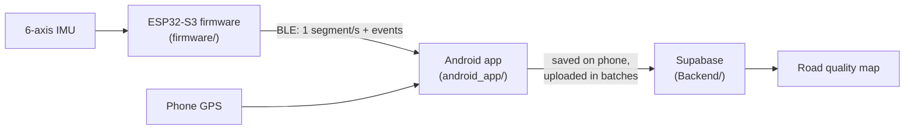

# Road Quality Mapper — EE475 Autumn 2026, Team 5

A low-cost, plug-in device that turns ordinary driving into a continuous road survey. A small
IMU-based sensor rides in the car, detects potholes and speed bumps, and grades how rough the
road is. An Android phone adds GPS location to each reading and uploads it to a shared database,
which drives a color-coded road quality map.

📄 **[Product Requirements Document](https://sites.google.com/uw.edu/ee475aut26team5/product-requirements-document)**

## Why

Road condition data is expensive and slow to collect. Agencies rely on periodic surveys and
one-off resident reports, and the roughness data that navigation apps gather isn't available to
them. This project aims to give transportation departments (such as WSDOT and city public works)
and fleet operators an inexpensive, hands-off way to keep that data current:

- **Non-invasive.** It is powered from the 12 V accessory socket, needs no vehicle modification,
  and needs nothing from the driver while driving.
- **Automatic detection.** It finds potholes and speed bumps from motion data and places them
  on a map.
- **Comparable scores.** Roughness is normalized for speed and vehicle, so a truck, a sedan and
  an SUV give comparable results.
- **Shared map.** It shows live results in the car and a combined map of many trips and vehicles.

Target metrics in the PRD include ≥ 80% detection of labeled potholes and speed bumps, a median
event location error of 10 m or less, and ≥ 95% message delivery. The device must also stay under
the $200 class budget.

## How it works

1. The **device** reads the IMU many times per second, scores roughness over roughly 1-second
   segments, and flags potholes and speed bumps.
2. It sends segment summaries and events to the **phone** over Bluetooth Low Energy.
3. The **app** stamps each message with where the car was at that time (phone GPS) and saves it
   on the phone first, so nothing is lost when there's no signal.
4. The app uploads to the **backend** in batches. The backend combines all trips into per-road,
   per-direction roughness and merged event locations.
5. Both the app's Map tab and a planned read-only web map draw roads green → yellow → red →
   dark red, with markers for potholes and speed bumps.

All three parts follow one shared spec, **[docs/data-contract.md](docs/data-contract.md)**. It
defines the BLE messages, the time sync, the units, the database tables and the map functions.
Any change to how the parts talk to each other goes there first.

## Repository layout

| Folder | What it is |
|---|---|
| [`firmware/`](firmware/) | ESP32-S3 firmware for the sensing device (Arduino / FreeRTOS) |
| [`android_app/`](android_app/) | Android app: connects to the device, records trips, shows the map |
| [`Backend/`](Backend/) | Self-hosted Supabase: database schema, access rules, map functions, server notes |
| [`docs/`](docs/) | The data contract shared by all three parts |
| [`tools/`](tools/) | Test helpers, such as a fake BLE device |

### `firmware/` — the sensing device

> The first draft lives on the [`firmware`](https://github.com/henryqla/ee475aut26team5/tree/firmware) branch and has not been merged
> into `main` yet.

Arduino sketch `road_quality_fw/` for an ESP32-S3 (DevKitC-1 on a breadboard for now, moving to
a custom PCB) with an LSM6DSO32X 6-axis IMU on SPI. It is built as four FreeRTOS tasks connected
by queues:

- **`imu_acq`** owns the SPI bus and reads one sample at 416 Hz on each data-ready interrupt.
- **`dsp`** maps chip axes to car axes and removes gravity with a high-pass filter. It then
  applies thresholds and a lockout window, and classifies each hit: roll-dominant is a
  *pothole*, pitch-dominant is a *speed bump*.
- **`serial_out`** owns the serial port and prints samples, events and health lines.
- **`supervisor`** watches every task's heartbeat and the IMU. On any fault it puts the device
  into a single safe state and reports a fault code.

Every tunable value is in `config.h` and every pin is in `board_pins.h`. Phase 1 reports over
USB serial only. BLE output, microSD logging and time sync, as described in the data contract,
come next.

### `android_app/` — the phone app

Kotlin + Jetpack Compose app (`uw.edu.roadqualitymapper`), for Android 12 or newer, with three
tabs:

- **Connect:** scans for and pairs with the device over BLE (Nordic Android-BLE-Library), and
  picks which vehicle the phone is in.
- **Drive:** starts and stops a trip. A foreground `RecordingService` keeps recording with the
  screen off. It matches each device message to a GPS fix by time and saves everything to a
  local **Room** database. Passengers can tap *Pothole!* or *Speed bump!* to label events.
- **Map:** a Google Map with roads colored by roughness and pins for events, loaded from the
  backend's map functions.

`TripUploader` sends anything not yet on the server in batches of about 60 rows: every minute
during a trip, when a trip ends, and at app start. Re-sent rows are skipped, so retrying is always
safe. The app signs in to Supabase anonymously, so the user never needs an account. A built-in
fake drive (debug builds only) shows the map before real data exists.

**Setup:** put `MAPS_API_KEY`, `SUPABASE_URL` and `SUPABASE_PUBLISHABLE_KEY` in
`android_app/local.properties`. This file is never committed; `local.defaults.properties` holds
the placeholders.

### `Backend/` — the database and server

A **self-hosted [Supabase](https://supabase.com)** (PostgreSQL + PostGIS + auth). It runs in
Docker on a team laptop and is reachable from phones through a Tailscale Funnel URL.

- **`supabase/migrations/`** holds the schema, applied in order:
  - **Tables:** `vehicles` (each team car, with a calibration scale factor), `trips`,
    `segments` (about 1 s of road each, with roughness, location, speed and heading) and
    `events` (potholes and speed bumps).
  - **Access rules (row-level security):** anyone can read the map data. A signed-in phone can
    only add rows to its own trips, and nobody can delete through the API.
  - **Map functions**, which the app and the web map call so both show the same thing:
    - `road_quality_in_area` groups segments into grid cells and travel directions, then takes
      the median over drives.
    - `events_in_area` merges nearby hits of the same kind and counts *hits vs. passes* as a
      confidence measure.
- **`checks/`** holds shell scripts that test a running server: that the keys are safe to expose,
  that the access rules work, and that the map functions return what the contract says.
- **`SUPABASE_SETUP.txt`** gives first-time setup steps for the server laptop.
  **`SERVER_START_STOP.txt`** gives the day-to-day start, stop and update steps.

### `tools/`

- **`fake_device/fake_device.ino`** is an ESP32 sketch that speaks the real device's BLE
  protocol but sends made-up roughness and events. Use it to test the app before the real
  firmware has BLE. Its trips are tagged `FAKE_DEVICE`, which keeps them off the real map.

## Status

This is an in-progress course project. The plan runs through five milestones: foundations, first
data flow, test-drive data collection, full integration, and a final demo on **Dec 10, 2026**.
Thresholds, roughness color cutoffs and the vehicle normalization are placeholders until the
team runs calibration drives. See the
[PRD](https://sites.google.com/uw.edu/ee475aut26team5/product-requirements-document) for the
full requirements, milestones and success metrics.
