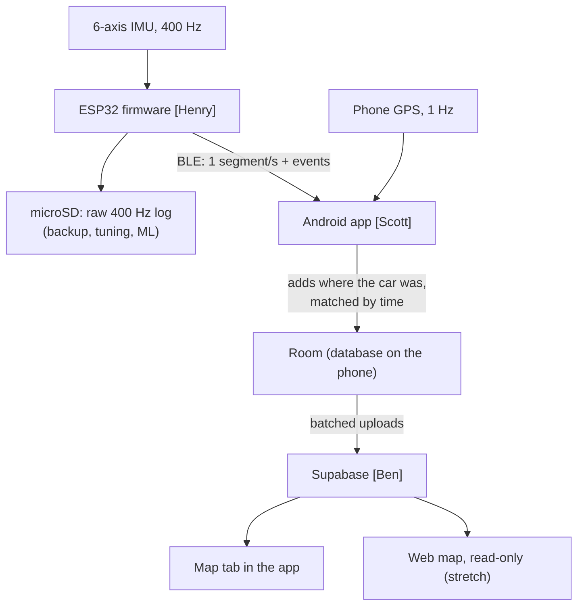

# Road Quality Mapper — Data Contract

**Version 0.3 — DRAFT for team review (Oct 2026).** Owner: **Scott** (keeps this file up to date).
Everything here is a proposal. Sections marked **[Henry]** or **[Ben]** need that person's OK;
the app adapts. Once agreed, changes go through this file so firmware, app, and backend stay in sync.
What changed since v0.2 is listed in §10.

---

## 1. Pipeline overview


(GitHub draws this as a diagram. In an editor without diagram support, read the arrows:
IMU → firmware → SD card and BLE → app (+ GPS) → phone database → Supabase → maps.)

| Data | Rate | Lives in | Owner |
|---|---|---|---|
| Raw IMU samples | 400 Hz | microSD only | Henry / Kyle |
| Segment summaries + events | 1/s + as detected | BLE → phone | Henry produces, app receives |
| Phone GPS fixes (lat, lon, speed, heading, accuracy) | 1/s | phone | app |
| Stamped segments + events | 1/s + as detected | Supabase | app uploads, Ben stores |

---

## 2. Time: one clock for everything

All timestamps in BLE messages and SD rows are **phone time: Unix epoch milliseconds**
(e.g. `1792500000000`). Use a 64-bit integer (`int64_t` / `uint64_t`) on the ESP32.

**Sync procedure**
1. On every BLE connect, and then **every 60 s**, the app writes the phone's current
   epoch ms to the TIME characteristic (§3).
2. Firmware stores `offset = phone_ms − millis()` at the moment it receives the write.
3. Firmware stamps everything with `millis() + offset`.
4. Firmware **writes a sync row to the SD log** each time (`millis`, `phone_ms`), so SD data
   recorded *before* the first sync can still be corrected afterwards.
5. Until the first sync, firmware sets `"synced": false` on BLE messages (app discards or
   re-times them).

Why re-sync every 60 s: the ESP32 clock drifts (~0.1–0.2 s per hour). BLE write latency adds
~10–50 ms of error to each sync, which is ~1 m at highway speed — acceptable.

Every SD row also keeps the raw `millis()`, so it can always be re-timed afterwards.

Early drives that log only to the SD card (before BLE works) are for Henry's firmware tuning and
are not put on the map, so they need no time sync.

---

## 3. BLE interface [Henry, app]

| Item | UUID | Properties | Direction |
|---|---|---|---|
| Service | `6f9e0001-3c2a-4b8e-9d41-7a5c2e8b1f30` | — | — |
| DATA characteristic | `6f9e0002-3c2a-4b8e-9d41-7a5c2e8b1f30` | Notify | device → app |
| TIME characteristic | `6f9e0003-3c2a-4b8e-9d41-7a5c2e8b1f30` | Write | app → device |

- UUIDs are random; any values work as long as both sides match.
- One JSON object per notification, UTF-8, no trailing newline.
- Suggested ESP32 library: **NimBLE-Arduino** (lighter and better documented than the default BLE stack).

**Packet size**
- BLE's default packet carries only **20 bytes** of data (default MTU of 23 bytes, minus 3 bytes
  of header). Right after connecting, the app asks for a bigger MTU of **247**, which allows
  **244 bytes** per notification. ESP32-S3 (NimBLE) and Android both support this; newer Android
  versions may negotiate even more (up to 517), which is fine.
- Our messages are ~120–180 bytes (§4), so **each message fits in one notification**.
- A notification longer than MTU − 3 bytes is **cut off, not split**. So:
  - **App, on connect, in this order:** connect → request MTU → discover services → subscribe to
    DATA → write TIME. If the MTU comes back below 247, the app logs an error and disconnects.
  - **Firmware** sends DATA notifications only after the app has subscribed (which is always after
    the MTU is set), never sends a message over 244 bytes, and rounds decimals to 3 places
    (ArduinoJson prints up to 9 digits by default, which wastes space).
- Data rate is ~1 message/s × ~150 bytes ≈ 0.15 KB/s, far below what BLE can carry, so throughput
  and connection intervals aren't a concern.

**Why JSON and not a packed byte layout:** streaming every raw sample (e.g. 50 Hz) would need a
compact binary layout squeezed into 20 bytes, with an agreed byte order (little vs big endian).
We send 1 s summaries instead, so size doesn't matter, and JSON is readable in any BLE scanner app
(e.g. nRF Connect), needs no byte-order agreement, and lets us add fields without breaking the
app. If we ever stream raw samples over BLE, revisit this.

**Finding our device in a crowded room [Henry, app]**

The demo room will have dozens of Bluetooth devices (phones, laptops, other teams' ESP32s). The
app only ever shows and connects to **our** device:
- **First connection:** the app scans with a filter for our **service UUID** (table above). It's
  random and unique to this project, so the phone's Bluetooth chip ignores every other device in
  the room before the app even sees it. No long list to pick from. The name `RoadQuality` is a
  second check, and is what the app shows on screen.
- **After that:** the app remembers this exact device (its Bluetooth address) and reconnects to it
  directly and automatically, e.g. after the car is turned off and on.
- **Before the demo:** connect early and stay connected. A crowded room slows down scanning, but
  an open connection copes much better (BLE hops between channels to avoid interference).

What firmware must do for this:
- Advertise **continuously whenever no phone is connected**, and **restart advertising after a
  disconnect**. Without this the phone can never reconnect. AI-written firmware often forgets to
  start advertising at all.
- Put the **service UUID** in the advertising packet and the name in the **scan response**:
  flags (3 bytes) + 128-bit UUID (18) + name (13) don't fit in the 31-byte advertising packet.
- Advertising interval ~100 ms. The car powers it, so there's no battery reason to go slower, and
  the phone finds it faster.

Not used (for now): BLE's *directed* advertising, where the device advertises to one specific
phone's Bluetooth address. Android changes its Bluetooth address periodically for privacy unless
the two devices are **paired** (bonded), so directed advertising also needs pairing. The UUID
filter plus the remembered address already gives "only our device, reconnect fast" without
pairing. If reconnects turn out slow in testing, pairing + directed advertising can be added later.

---

## 4. Messages: device → app (DATA characteristic)

All messages share: `type` (string), `seq` (integer, +1 per message, any type; lets the app
detect drops), `synced` (bool, see §2).

### 4.0 Car axes and mounting [Henry, Kyle]

This is about which way the **box faces inside the car**, not which way the car faces on the map.
The device never needs compass direction; the phone's GPS provides that (`heading_deg`, §6).

`rms_z`, roll, and pitch only mean something in the **car's** axes, not the IMU chip's:

| Axis | Points | Rotation around it |
|---|---|---|
| x | forward (the way the car drives) | **roll**: side-to-side rocking |
| y | left | **pitch**: nose up/down |
| z | up | yaw: turning (not sent) |

Why it matters: speed bumps show up mostly as **pitch** (both front wheels, then both rear),
potholes as **roll** (usually one wheel). If the axes are mixed up, that test stops working.

The IMU measures along its own chip's axes. To convert to the car's axes, firmware needs two things:
- **Which way is up:** from gravity, measured with the car parked at power-on. This also corrects
  for a tilted mount.
- **Which way the front of the car is:** gravity can't tell it this. If the box sits rotated 90°,
  a speed bump's nose-up/down motion lands on the chip's side-to-side axis, and potholes and speed
  bumps get mixed up. So the box must always be mounted the same way, with a known side toward
  the front of the car.

That's what the **"FRONT →" arrow** is: a mounting instruction marked on the enclosure. It
doesn't send anything to the device; firmware simply assumes the box was mounted that way.
- **Kyle:** mark the arrow on the enclosure. Ideally the case fits the PCB only one way and the
  mount fits the car only one way. Tell Henry which IMU chip axis the arrow points along (from the
  PCB layout and the axis diagram in the IMU's datasheet).
- **Henry:** hard-code that chip axis as forward, then apply the gravity tilt correction.
- **Whoever mounts it:** arrow toward the front of the car, roughly level, rigidly attached.
  Backwards only flips signs (harmless for RMS values); sideways swaps roll and pitch.

Optional later: detect forward automatically during a straight-line brake. Not needed if the
arrow is followed.

Gravity removal: after rotating into car axes, subtract 1 g from z, or high-pass filter z
(~0.5 Hz), which also removes the slow tilt from driving on hills.

IMU ranges: accelerometer **±8 g or ±16 g** (big hits shouldn't clip), gyroscope **±500 deg/s**.

The SD log keeps the **raw chip axes**, with the calibration (rotation) written at the top of
each file, so the rotation can be redone afterwards if it turns out wrong.

### 4.1 Segment summary — `seg`, 1 per second
```json
{"type":"seg","seq":1042,"synced":true,"t_start":1792500000000,"t_end":1792500001000,
 "n":400,"rms_z":0.041,"peak_z":0.22,"roll_rms":1.8,"pitch_rms":2.1}
```

| Field | Unit | Meaning |
|---|---|---|
| `t_start`, `t_end` | epoch ms | First and last sample time of the 1 s window |
| `n` | count | Samples in the window (expect 400; fewer means dropped samples) |
| `rms_z` | g | **Roughness.** RMS of vertical acceleration, **gravity removed**, in car axes (§4.0) |
| `peak_z` | g | Largest absolute vertical acceleration in the window |
| `roll_rms` | deg/s | RMS of roll rate (side-to-side rocking) |
| `pitch_rms` | deg/s | RMS of pitch rate (nose up/down) |

### 4.2 Event — `evt`, when detected
```json
{"type":"evt","seq":1043,"synced":true,"t":1792500000420,"class":"pothole",
 "peak_z":1.9,"roll_peak":45.0,"pitch_peak":12.0,"conf":0.7}
```

| Field | Unit | Meaning |
|---|---|---|
| `t` | epoch ms | Time of the **peak**, not the time the event was sent (detection can lag) |
| `class` | — | `"pothole"`, `"speed_bump"`, or `"unknown"` |
| `peak_z` | g | Peak vertical acceleration (gravity removed) |
| `roll_peak`, `pitch_peak` | deg/s | Peak roll / pitch rate during the event |
| `conf` | 0–1 | Detector confidence (use `1.0` if the detector doesn't produce one) |

### 4.3 Status — `status`, on connect (optional but very helpful for debugging)
```json
{"type":"status","seq":0,"synced":false,"fw":"0.1.0","imu_ok":true,"sd_ok":true,"rate_hz":400}
```

---

## 5. Messages: app → device (TIME characteristic)
```json
{"type":"time","t":1792500000000}
```
Written on connect and every 60 s (§2).

---

## 6. What the app does with each message [app]

- Records phone GPS fixes at 1 Hz using each fix's **own measurement time** (not arrival time).
- Stores fixes and incoming messages **as received** in the phone's local database (Room),
  so drives survive no signal / app restarts and can be re-processed or replayed later.
- Waits ~1–2 s for the GPS fix *after* each message, then **interpolates** between the two
  surrounding fixes:
  - segment → location at its midpoint `(t_start + t_end) / 2`
  - event → location at `t`
- If no fix exists within ±2 s, the segment is kept with **no location** (not dropped).
- Uploads stamped segments/events to Supabase in batches (~60 rows per request).

Fields the app adds to every uploaded segment and event: `lat`, `lon`, `speed_mps`,
`gps_accuracy_m`, `heading_deg`, `trip_id`, `source` (`REAL` / `FAKE_ASSET` / `FAKE_DEVICE`).
Events also get `vehicle_id`; segments get their vehicle through their trip.

| Field | Unit | Meaning |
|---|---|---|
| `lat`, `lon` | degrees | Interpolated position (see above) |
| `speed_mps` | m/s | GPS speed |
| `gps_accuracy_m` | m | Android's accuracy estimate for the fix (68% chance the true position is within this radius) |
| `heading_deg` | degrees | Direction of travel from GPS, clockwise from true north (0 = north, 90 = east). Lets the database keep the two directions of a road apart |

`lat`, `lon`, `speed_mps`, `gps_accuracy_m`, and `heading_deg` are `null` when no fix was close
enough in time. `heading_deg` is also `null` when the car is barely moving (GPS heading is
unreliable below ~1–2 m/s).

---

## 7. Supabase (suggestions only) [Ben]

**Tables** (snake_case; names and types are Ben's call). Postgres types below.

General rules:
- **Times** are epoch milliseconds as `bigint`, the same numbers the app and firmware use. (A
  readable `timestamptz` column can be generated from them if wanted.)
- **`lat`/`lon` are `double precision`**: a 4-byte `real` keeps only ~7 digits, which isn't enough
  for meter-level positions like `47.661303`. Sensor values are fine as `real`.
- **IDs for trips and events are UUIDs made by the app**, so trips can be created offline and
  uploaded later, and a re-sent batch updates rows instead of duplicating them (upsert).
- `source` is `REAL`, `FAKE_ASSET`, or `FAKE_DEVICE`; `class` and `user_label` are `pothole`,
  `speed_bump`, or `unknown`.
- Size: ~1 row per second of driving ≈ 1 MB per hour of driving; the free tier's database limit
  is far beyond what we'll use.

`vehicles`

| Column | Type | Notes |
|---|---|---|
| `id` | `text` **primary key** | Short readable IDs: `truck`, `camry`, `escape` |
| `name` | `text` not null | |
| `type` | `text` not null | `truck`, `sedan`, `suv` |
| `scale_factor` | `double precision` not null, default `1.0` | From calibration drives |

`trips`

| Column | Type | Notes |
|---|---|---|
| `id` | `uuid` **primary key** | Made by the app when the trip starts |
| `vehicle_id` | `text` not null → `vehicles.id` | |
| `start_time` | `bigint` not null | |
| `end_time` | `bigint` | `null` while the trip is in progress |
| `source` | `text` not null | |
| `app_version` | `text` | |

`segments` — **primary key is (`trip_id`, `t_start`)**: a trip can't have two segments starting at
the same millisecond, so re-sent segments overwrite instead of duplicating.

| Column | Type | Notes |
|---|---|---|
| `trip_id` | `uuid` not null → `trips.id` | |
| `t_start`, `t_end` | `bigint` not null | |
| `lat`, `lon` | `double precision` | `null` when no GPS fix (§6) |
| `speed_mps`, `gps_accuracy_m`, `heading_deg` | `real` | `null` when no GPS fix |
| `rms_z`, `peak_z`, `roll_rms`, `pitch_rms` | `real` not null | |
| `source` | `text` not null | |
| `geog` | generated `geography(Point)` | Computed from `lon`/`lat`; `null` when they are |

`events`

| Column | Type | Notes |
|---|---|---|
| `id` | `uuid` **primary key** | Made by the app |
| `trip_id` | `uuid` not null → `trips.id` | |
| `vehicle_id` | `text` not null → `vehicles.id` | |
| `t` | `bigint` not null | |
| `lat`, `lon` | `double precision` | `null` when no GPS fix |
| `speed_mps`, `gps_accuracy_m`, `heading_deg` | `real` | `null` when no GPS fix |
| `class` | `text` not null | |
| `peak_z`, `roll_peak`, `pitch_peak`, `conf` | `real` not null | |
| `user_label` | `text` | Set from the Drive screen's label buttons |
| `source` | `text` not null | |
| `geog` | generated `geography(Point)` | Computed from `lon`/`lat` |

**Suggestions**
- App sends plain `lat` / `lon` numbers; the database computes a PostGIS geography column
  from them (generated column). Neither the app nor the web map reads PostGIS types directly.
- **Map logic lives in SQL functions**, so the app and the web map always show the same thing:
  - `road_quality_in_area(south, west, north, east, …filters)`: segments combined per small
    area **and per direction of travel** (`heading_deg`), with vehicle/speed normalization
    applied. Median rather than average, so one odd drive doesn't skew a road.
  - `events_in_area(south, west, north, east, …)`: events merged into one when they are within
    **10 m** of each other, have the same `class`, and headings within ~45° (so potholes on
    opposite sides of a road stay separate). Merged position = average of the hits. Returns the
    number of drives that hit it and the number of drives that passed that spot in the same
    direction; the map shows this as "hit by N of M drives".
  - 10 m is a starting value: GPS is typically off by 3–5 m per fix. Measure the real spread by
    driving over the same speed bump ~10 times, and adjust.
- Row Level Security: the app can insert + read; the web map can **only read**.
- Free-tier projects pause after ~1 week without activity (data is kept; resume from the dashboard).

---

## 8. Map display (shared by app and web map)

- Segments drawn as lines colored by (normalized) roughness, like Google Maps traffic:
  **green** (new pavement) → **yellow** → **light red** (≈ I-5) → **dark red** (worse).
- Numeric thresholds are **TBD** from calibration drives (new construction = green baseline,
  I-5 = light red) and will be listed here once measured, so both maps use identical values.
- Each direction of a road is drawn on its own side (offset to the right of travel, as US traffic
  drives on the right). Zoomed out, the two directions overlap.
- Lines are about 5 m wide on the ground, so they widen as you zoom in.
- Distinct markers for pothole and speed bump.
- Grading is per direction, **not per lane**: phone GPS can't reliably tell lanes apart.

---

## 9. Decisions needed

**Henry (firmware)**
- [ ] OK with the fields and units in §4? Anything you'd add or drop?
- [ ] OK with the car axes, mounting, gravity removal, and IMU ranges in §4.0?
- [ ] OK with phone-time stamping + 60 s re-sync (§2), and sync rows in the SD log?
- [ ] OK with the packet-size and advertising rules in §3 (restart advertising after disconnect)?
- [ ] BLE library (NimBLE-Arduino?) and JSON (ArduinoJson?) OK?
- [ ] Rough date for a firmware build that sends fake `seg`/`evt` messages over BLE?

**Kyle (hardware)**
- [ ] "FRONT →" arrow on the enclosure, and a rigid, roughly level mount (§4.0)
- [ ] How the IMU chip's axes sit relative to the arrow (from the PCB layout), for Henry

**Ben (backend)**
- [ ] Final table and column names, types, and primary keys (§7)
- [ ] Anonymous sign-in for the app, or another auth approach?
- [ ] RLS policies: app read/write, web read-only
- [ ] Who writes the aggregation/normalization SQL functions, and when?
- [ ] OK with grouping by direction (`heading_deg`) and the event-merge rules in §7?

**Team**
- [ ] Confirm IMU rate 400 Hz and 1 s segment windows
- [ ] Vehicle list and IDs (truck, Camry, Escape)
- [ ] Where speed normalization happens (proposal: in the SQL functions, after calibration drives)
- [ ] Web map owner and timing (after the app → Supabase → map pipeline works)
- [ ] Per-direction (not per-lane) grading is acceptable for the project

---

## 10. Changes since v0.2

- Scott owns this file.
- App adds `heading_deg` (GPS direction of travel) to segments and events (§6, §7).
- Events table now has `gps_accuracy_m`, matching segments (§7).
- Clarified that `vehicle_id` is on events and trips; segments get it through their trip (§6).
- Unit table for the app-added fields, and when they are `null` (§6).
- Suggested per-direction grouping and event-merge rules for the SQL functions (§7).
- Map display: per-direction lines, zoom-scaled width, per-direction not per-lane (§8).
- Pipeline overview redrawn as a Mermaid diagram (§1).
- `millis()` kept on every SD row; SD-only test drives need no time sync (§2).
- BLE packet size (20-byte default, MTU 247), connect order, and why JSON (§3).
- Finding our device in a crowded room: UUID scan filter, remembered device, advertising rules (§3).
- Car axes, mounting arrow, gravity removal, and IMU ranges (§4.0).
- Column types, primary keys, and app-made UUIDs for the tables (§7).
