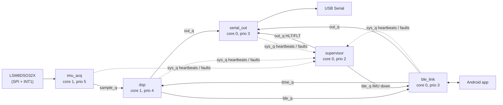

# Firmware Summary

This document summarizes the firmware built for the Road Quality Mapper sensing device: what each
sketch does, how the main firmware is structured, and the design choices behind it. The device-to-app
interface is defined in [`docs/data-contract.md`](../docs/data-contract.md); this summary refers to
it as "the contract".

**Status:** the main firmware (`road_quality_fw`, v0.2.0) runs on the team PCB and has been tested
end to end with the Android app. Events are detected and delivered over BLE, and road quality data
maps correctly onto the app's map.

---

## 1. What has been built

| Sketch | Location | Purpose |
|---|---|---|
| **Road quality firmware** | [`firmware/road_quality_fw/`](road_quality_fw/) | The product firmware. Samples the IMU at 416 Hz, computes 1 s road roughness summaries, detects and classifies potholes and speed bumps, and streams results to the app over BLE. |
| **PCB bring-up tool** | [`firmware/bring-up/imu_readout/`](bring-up/imu_readout/) | Standalone test sketch used to bring up the custom PCB. Confirms the IMU answers over SPI, accepts its settings, and returns sane data. |
| **Fake device** | [`tools/fake_device/`](../tools/fake_device/) | An ESP32 that speaks the same BLE protocol as the real device but sends made-up data. Used to develop and test the app before the real firmware had BLE. |

### Hardware target

- **MCU:** ESP32-S3-WROOM-1-N16R8 on the team's custom PCB (dual core, 16 MB flash)
- **IMU:** ST LSM6DSO32X 6-axis accelerometer + gyroscope, on SPI
- **Pins:** SCK 14, MISO 12, MOSI 13, CS 21, INT1 (data-ready) 11
- **Serial / upload:** the S3's native USB (GPIO19/20); the PCB has no USB-UART bridge

---

## 2. Road quality firmware (`road_quality_fw`)

### 2.1 Key features

- **416 Hz IMU sampling, paced by the IMU's data-ready interrupt**, with every sample timestamped
  in microseconds and numbered from boot.
- **Gravity removal** with a 0.5 Hz first-order high-pass filter on vertical acceleration. This
  also removes slow tilt from driving on hills.
- **1 s segment summaries** (the road roughness data): RMS and peak vertical acceleration, plus
  RMS roll and pitch rate.
- **Event detection** of potholes and speed bumps by thresholding, with a lockout window so one
  pothole hit by both axles counts once.
- **Event classification** by which rotation dominates: roll-dominant → pothole (usually one
  wheel), pitch-dominant → speed bump (both front wheels, then both rear), otherwise unknown.
- **BLE link to the Android app** (NimBLE) using JSON messages: `status`, `seg`, and `evt`.
- **Phone time sync**: the app writes its clock over BLE, and the firmware stamps all data in
  phone epoch milliseconds so the app can match it to GPS.
- **Serial telemetry over USB**: decimated raw samples, segments, events, BLE link changes, and a
  once-per-second health line with drop and error counters.
- **Fault detection and a single safe state**, reported both on Serial and to the app.

### 2.2 Architecture

The firmware runs on FreeRTOS. `setup()` creates five queues and five tasks, then deletes itself,
so `loop()` never runs. Each task owns its peripheral, and tasks share data only through queues.

| Task | Core | Priority | Owns | Job |
|---|---|---|---|---|
| `imu_acq` | 1 | 5 (highest) | SPI bus, IMU | Initializes the IMU, reads one sample per data-ready interrupt, checks `WHO_AM_I` once per second |
| `dsp` | 1 | 4 | — | Axis mapping, high-pass filter, segment summaries, event detection and classification |
| `serial_out` | 0 | 3 | Serial (USB) | Turns queue items into one text line each |
| `ble_link` | 0 | 3 | BLE | Advertising, connection handling, JSON formatting, time sync |
| `supervisor` | 0 | 2 (lowest) | — | Heartbeat watchdog, health reporting, safe state |

| Queue | Producer → consumer | Length | Contents |
|---|---|---|---|
| `sample_q` | imu_acq → dsp | 104 (0.25 s) | IMU samples |
| `out_q` | dsp, ble_link, supervisor → serial_out | 32 | Lines to print |
| `ble_q` | dsp, BLE callbacks, supervisor → ble_link | 16 | Segments, events, link changes, IMU-down notice |
| `time_q` | BLE TIME callback → dsp | 1 | Latest phone time sync (overwritten, never queued) |
| `sys_q` | all tasks → supervisor | 16 | Heartbeats and fault reports |

**Source files**

| File | Contents |
|---|---|
| `road_quality_fw.ino` | Creates queues and tasks |
| `config.h` | Every tunable number (rates, thresholds, queue lengths, priorities, BLE settings) |
| `board_pins.h` | Every GPIO number |
| `types.h` | Queue item structs, event classes, fault codes, shared context |
| `imu_acq.cpp`, `dsp.cpp`, `serial_out.cpp`, `ble_link.cpp`, `supervisor.cpp` | One file per task |

### 2.3 Data path

**Acquisition (`imu_acq`).** The IMU is configured for 416 Hz on both sensors, ±16 g accelerometer,
±500 dps gyroscope, with accelerometer data-ready routed to INT1. A rising edge on INT1 triggers an
ISR that only notifies the task; the task does the SPI read, stamps the sample with
`esp_timer` microseconds and a sample count, and queues it without waiting. After init the
firmware reads the IMU settings back to confirm the SPI writes landed.

**Signal processing (`dsp`).** For each sample:

1. Map chip axes to car axes (vertical, roll, pitch). This is the only place the mapping happens.
2. High-pass the vertical acceleration: `y[n] = a·(y[n-1] + x[n] − x[n-1])`, with `a` computed
   from the cutoff and sample rate (≈ 0.9925). The filter is seeded with the first sample so boot
   does not start with a 1 g step.
3. Add the sample to the current 1 s segment.
4. Run the event detector.

**Segments.** Segment windows are fixed to the local clock (each window is one whole second of
`esp_timer` time). The first sample of a new window closes the previous one and sends a `seg` with
`rms_z`, `peak_z`, `roll_rms`, `pitch_rms`, the sample count `n` (416 or 417), and first/last sample
times.

**Event detection.**

- A 2 s settle hold-off after boot lets the high-pass filter settle before detection starts.
- A lockout window opens when any axis crosses its threshold (vertical accel, roll rate, or pitch
  rate). One window is shared by all axes.
- Inside the window, the firmware tracks each axis's peak in "threshold units" (|value| ÷
  threshold) so axes with different units can be compared directly. It records the sample number
  and time of the largest peak.
- When the window closes (1.25 s), it classifies the event and sends an `evt` stamped at the
  largest peak, not at the time it was sent.
- Classification: roll peak ≥ 1.5 × pitch peak → `pothole`; pitch peak ≥ 1.5 × roll peak →
  `speed_bump`; otherwise `unknown`.

### 2.4 BLE link (`ble_link`)

Implements the device side of contract sections 3–5 using NimBLE-Arduino 2.x.

| Item | Value |
|---|---|
| Device name | `RoadQuality` (in the scan response) |
| Service UUID | `6f9e0001-3c2a-4b8e-9d41-7a5c2e8b1f30` (in the advertising packet) |
| DATA characteristic | `…0002…`, Notify, device → app |
| TIME characteristic | `…0003…`, Write, app → device |
| MTU | 247 (244-byte payload) |
| Advertising interval | ~100 ms, continuous while disconnected, restarts after every disconnect |

**Messages** (one JSON object per notification, decimals rounded to 3 places):

- `status`: sent on every subscribe, and again if the IMU fails. Carries `fw` version, `imu_ok`,
  `sd_ok`, `rate_hz` (416), and `synced`.
- `seg`: one per second.
- `evt`: one per detected event.

Every message carries a `seq` number that counts all messages from 0 at boot, so the app can tell
a dropped message (gap) from a reboot (back to 0). A message that fails to send still uses up its
`seq`, so the gap appears exactly where data was lost.

Data is only sent while the app is subscribed. Nothing is buffered while disconnected.

### 2.5 Time synchronization

The app writes `{"type":"time","t":<epoch ms>}` to the TIME characteristic on connect and every
60 s. The firmware:

- records the local time the moment the write arrives, then computes `offset = phone_ms − local_ms`;
- applies a new offset **only at the next segment boundary**, so a segment's start and end times
  never come from two different clocks;
- stamps each event with the offset that was in use **when its peak was recorded**, so an event
  stays consistent with the segment containing it even if it is sent after the next segment;
- marks all messages `synced: false` until the first valid TIME write, and rejects TIME writes it
  cannot parse (reported on Serial instead of being applied).

### 2.6 Serial telemetry (`serial_out`)

Comma-separated text lines over USB, one record per line, each starting with a type tag. A `BOOT`
line at startup records the firmware version and every tunable setting, so each capture documents
how it was run. Lines starting with `#` name the columns.

| Tag | Rate | Contents |
|---|---|---|
| `BOOT` | once | Firmware version and all settings |
| `S` | 52/s (every 8th sample) | Raw sample in chip axes + filtered vertical accel |
| `SEG` | 1/s | Segment summary |
| `EVT` | per event | Event with class, peaks, and timestamps |
| `HLT` | 1/s | Health counters: samples, queue drops, data-ready timeouts, BLE sent/failed, Serial drops |
| `FLT` | 1/s after a fault | Fault code and name |
| `BLE` | per link change | advertising, connected, disconnected, MTU, subscribed, time sync |

The device runs normally with no computer attached: Serial never waits on the host. A line that
does not fit in the 4 KB USB transmit buffer is dropped whole (never cut in half) and counted.

### 2.7 Fault handling (`supervisor`)

| Code | Name | Detected by |
|---|---|---|
| F1 | `IMU_INIT_FAILED` | IMU did not answer or did not accept its settings at boot |
| F2 | `IMU_LOST` | `WHO_AM_I` mismatch at runtime, or no data-ready sample for 100 ms |
| F3 | `HEARTBEAT_MISSED` | Any task silent for 3 s (three missed 1 Hz heartbeats) |
| F4 | `BLE_INIT_FAILED` | BLE stack, service, or advertising failed to start |

Every task sends a heartbeat with its counters once per second. The supervisor wakes once per
second, collects heartbeats, and prints an `HLT` line. On any fault it enters **one safe state**,
the same for every fault: sampling and detection stop, while Serial and BLE keep running. It then
repeats an `FLT` line on Serial and tells `ble_link` to send `status` with `imu_ok: false`, every
second until reset, so a monitor or phone that connects late still sees the fault.

---

## 3. Design choices

**Architecture**

- **One owner per peripheral.** Only `imu_acq` touches SPI, only `serial_out` touches Serial, and
  only `ble_link` touches BLE. This avoids locks and makes it clear where each resource is used.
- **Tasks communicate only through queues.** No shared globals between tasks; one read-only
  context struct hands out the queue handles.
- **Core split.** Time-critical sampling and processing run alone on core 1. Serial, BLE (including
  NimBLE's own tasks), and the supervisor run on core 0, so wireless and USB activity cannot delay
  sampling.
- **ISRs and BLE callbacks do the minimum.** The data-ready ISR only wakes `imu_acq`; BLE callbacks
  only copy their data into a queue and return.
- **Producers never block.** Every send on the data path uses a zero timeout. If a consumer falls
  behind, the item is dropped and counted rather than stalling the sampling chain. The counters
  appear in the `HLT` line. The only blocking send is a fault report, since losing it would turn a
  specific fault into a vaguer heartbeat timeout.
- **All tunables in `config.h`, all pins in `board_pins.h`.** Unsupported IMU settings fail the
  build instead of silently running at a different value.

**Sensing and processing**

- **416 Hz sample rate.** The LSM6DSO32X has no 400 Hz option; 416 Hz is the nearest and nothing
  downstream needs exactly 400. The app checks `n` against `rate_hz` from `status`.
- **Interrupt-driven sampling** rather than polling, so each sample is timed by the IMU itself. If
  data-ready stops arriving, the task still wakes after 10 ms, reads to clear any latched
  interrupt, and discards that sample because its timestamp would be wrong.
- **±16 g accelerometer range** so large impacts do not clip; **±500 dps gyroscope** to match the
  contract.
- **High-pass filter for gravity removal** instead of subtracting 1 g, because it also handles a
  tilted mount and road grade.
- **On-device summarization.** Raw 416 Hz data is far more than BLE needs. Sending 1 s summaries
  plus events keeps BLE traffic around 150 bytes/s.
- **Segment windows tied to the local clock** so consecutive segments tile time with no gaps or
  overlaps and no samples are lost between windows.
- **Lockout window with peak reporting.** One event per 1.25 s window prevents double counting
  front and rear axles, and reporting the largest peak's time gives the app the most accurate
  location.
- **Classification by roll vs. pitch dominance** uses vehicle dynamics: a pothole usually hits one
  wheel (roll), a speed bump hits both wheels on an axle (pitch).

**BLE and time**

- **JSON instead of a binary format.** Messages fit in one notification after MTU negotiation, are
  readable in any BLE scanner, need no byte-order agreement, and allow fields to be added without
  breaking the app.
- **Service UUID in the advertising packet, name in the scan response**, because both do not fit
  in one 31-byte packet. The app filters scans by UUID, so it finds only our device in a crowded
  room.
- **Continuous advertising and auto-restart after disconnect** so the phone can always reconnect.
- **`status` on every subscribe** so the app always learns the firmware version (stored with each
  trip) and the sensor state before any data arrives.
- **Phone time with offsets applied at segment boundaries** so all timestamps share the GPS clock
  and each segment is internally consistent.
- **Real firmware versions never start with `fake`**, so the app can tell real trips from
  fake-device test trips and keep test data off the map.

**Robustness**

- **Settings read back after IMU init** catch a broken MOSI line at boot instead of producing
  wrongly scaled data.
- **`WHO_AM_I` checked every second** catches a broken MISO or CS line, which would otherwise keep
  producing garbage samples while INT1 continues to fire.
- **Pull-down on INT1** so a broken interrupt line reads low (triggering F2) instead of floating
  and firing at random.
- **A single safe state for all faults**, with fault reporting repeated every second on both
  Serial and BLE.

---

## 4. Supporting firmware

### 4.1 PCB bring-up tool (`bring-up/imu_readout`)

A simple `setup()`/`loop()` sketch with no tasks, used to verify the custom PCB before running the
full firmware.

- Configures the IMU at the project rate (416 Hz) over SPI at a slow 1 MHz clock, so a failure
  points to wiring rather than timing.
- Prints one CSV line per second: acceleration (g), angular rate (dps), and temperature (°C).
- Checks `WHO_AM_I` before every read and reads settings back after init. On failure it prints an
  `ERR` line once per second with a hint at the likely cause: `0x00`/`0xFF` means no answer
  (check power, CS, MISO), any other value means corrupt data or the wrong part, and failed
  read-back means writes are not landing (check MOSI).
- Uses the same pins, SPI setup, and `WHO_AM_I` approach as the main firmware, so a passing
  bring-up confirms the hardware the main firmware relies on.

### 4.2 Fake device (`tools/fake_device`)

An ESP32 sketch that implements the same BLE interface as the real firmware (same UUIDs, name,
advertising, and JSON messages) but generates data instead of reading an IMU:

- sends `status` on subscribe, one `seg` per second with roughness that wanders up and down, and
  an `evt` every 15 s alternating pothole and speed bump;
- respects TIME writes and the `synced` flag;
- reports a `fw` version starting with `fake`, so the app tags its trips `FAKE_DEVICE`.

This let the app and backend be developed in parallel with the firmware. The real firmware's BLE
module was adapted from it.

---

## 5. Testing and validation

- **PCB bring-up:** the bring-up tool checks the IMU on the custom PCB (SPI reads, setting
  read-back, live data) before the main firmware runs on it.
- **App + firmware integration:** tested end to end with the Android app. The app connects,
  receives `status`, `seg`, and `evt` messages, and syncs time. Events are detected and appear in
  the app, and road quality from the segment data maps correctly onto the app's map.

---

## 6. Building

| Setting | Value |
|---|---|
| IDE | Arduino IDE 2.3.10 |
| Board package | esp32 by Espressif, core 3.3.10 |
| Board | ESP32S3 Dev Module |
| Flash size | 16 MB |
| PSRAM | Disabled |
| USB CDC On Boot | Enabled |
| USB Mode | Hardware CDC and JTAG |
| Upload Mode | UART0 / Hardware CDC |
| Libraries | Adafruit LSM6DS, Adafruit BusIO, Adafruit Unified Sensor, NimBLE-Arduino 2.x |

`serial_out.cpp` refuses to build unless USB CDC On Boot and Hardware CDC mode are set, since the
PCB has no other Serial path. If the USB port does not appear, hold BOOT and press reset to enter
download mode.
