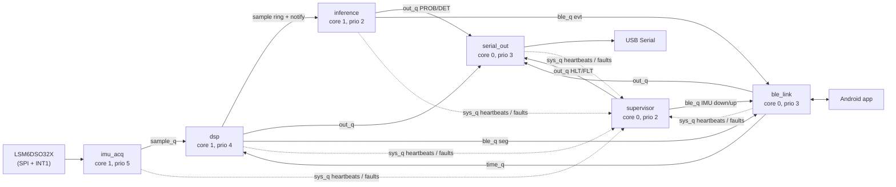

# Firmware Summary

This document summarizes the firmware built for the Road Quality Mapper sensing device: what each
sketch does, how the main firmware is structured, and the design choices behind it. The device-to-app
interface is defined in [`docs/data-contract.md`](../docs/data-contract.md); this summary refers to
it as "the contract".

**Status:** the main firmware (`road_quality_fw`) is now **v0.3.0-pcb**: the PCB build of the bench
firmware (`firmware-bench` 0.2.0-bench), which detects potholes and speed bumps with an on-device
CNN instead of thresholds. On the DevKit bench it has passed the BLE event-link tests with the
Android app. **On the PCB it is not tested yet** (tests PCB-1 to PCB-6). The previous version,
v0.2.0 (threshold detection), ran on the team PCB and was tested end to end with the app; it is in
git at commit `88d2d1e`.

---

## 1. What has been built

| Sketch / tool | Location | Purpose |
|---|---|---|
| **Road quality firmware** | [`firmware/road_quality_fw/`](road_quality_fw/) | The product firmware, for the team PCB. Samples the IMU at 416 Hz, computes 1 s road roughness summaries, detects potholes and speed bumps with a CNN, and streams results to the app over BLE. |
| **Bench firmware** | [`firmware/firmware-bench/`](firmware-bench/) | The same code for a breadboarded ESP32-S3-DevKitC-1 and LSM6DSO32 breakout. New features are built and tested here first, then copied into `road_quality_fw` (section 2.8). |
| **CNN record GUI and training** | [`firmware/cnn/`](cnn/) | A desktop GUI that records labeled clips from the firmware's Serial stream, and `train.py`, which trains the CNN and writes `model_data.h`. |
| **PCB bring-up tool** | [`firmware/bring-up/imu_readout/`](bring-up/imu_readout/) | Standalone test sketch used to bring up the custom PCB. Confirms the IMU answers over SPI, accepts its settings, and returns sane data. |
| **Fake device** | [`tools/fake_device/`](../tools/fake_device/) | An ESP32 that speaks the same BLE protocol as the real device but sends made-up data. Used to develop and test the app before the real firmware had BLE. |

### Hardware target

- **MCU:** ESP32-S3-WROOM-1-N16R8 on the team's custom PCB (dual core, 16 MB flash)
- **IMU:** ST LSM6DSO32X 6-axis accelerometer + gyroscope, on SPI
- **Pins:** SCK 14, MISO 12, MOSI 13, CS 21, INT1 (data-ready) 11 (from `pin-map.md` v0.1; the
  DevKit bench is wired to the same GPIOs)
- **Serial / upload:** the S3's native USB (GPIO19/20); the PCB has no USB-UART bridge

---

## 2. Road quality firmware (`road_quality_fw`)

### 2.1 Key features

- **416 Hz IMU sampling, paced by the IMU's data-ready interrupt**, with every sample timestamped
  in microseconds and numbered from boot.
- **Gravity removal** with a 0.5 Hz first-order high-pass filter on vertical acceleration, and
  **gyro bias removal** on roll and pitch rate, measured over the first 2 s after boot.
- **1 s segment summaries** (the road roughness data): RMS and peak vertical acceleration, plus
  RMS roll and pitch rate.
- **CNN event detection.** Every 0.5 s a small 1-D CNN (TensorFlow Lite Micro) classifies the last
  2 s of vertical acceleration, roll rate and pitch rate as pothole, speed bump or none.
- **BLE link to the Android app** (NimBLE) using JSON messages: `status`, `seg`, and `evt`.
- **Phone time sync**: the app writes its clock over BLE, and the firmware stamps all data in
  phone epoch milliseconds so the app can match it to GPS.
- **Serial stream over USB**: every sample (for recording training clips), segments, model
  outputs, detections, BLE link changes, settings, and a once-per-second health line.
- **Fault handling**: the IMU recovers from a loose wire or power loss without a reset, a model
  problem stops only inference, and other faults enter one safe state. All are reported on Serial
  and to the app.

### 2.2 Architecture

The firmware runs on FreeRTOS. `setup()` creates five queues, starts the inference task (which
loads and self-tests the model), then starts the other five tasks and deletes itself, so `loop()`
never runs. Each task owns its peripheral, and tasks share data only through queues (plus one
lock-free sample ring between `dsp` and `inference`).



| Task | Core | Priority | Owns | Job |
|---|---|---|---|---|
| `imu_acq` | 1 | 5 (highest) | SPI bus, IMU | Initializes the IMU, reads one sample per data-ready interrupt, checks `WHO_AM_I` once per second, recovers the IMU after F1/F2 |
| `dsp` | 1 | 4 | — | Axis mapping, gyro bias removal, high-pass filter, segment summaries, hands samples to inference |
| `inference` | 1 | 2 | TFLite Micro model | Runs the CNN every 0.5 s, decides detections, builds `evt` |
| `serial_out` | 0 | 3 | Serial (USB) | Turns queue items into one text line each |
| `ble_link` | 0 | 3 | BLE | Advertising, connection handling, JSON formatting, time sync |
| `supervisor` | 0 | 2 | — | Heartbeat watchdog, health reporting, fault handling |

| Queue | Producer → consumer | Length | Contents |
|---|---|---|---|
| `sample_q` | imu_acq → dsp | 104 (0.25 s) | IMU samples |
| `out_q` | dsp, inference, ble_link, supervisor → serial_out | 256 (~0.6 s of samples) | Lines to print |
| `ble_q` | dsp, inference, BLE callbacks, supervisor → ble_link | 16 | Segments, events, link changes, IMU down/up notices |
| `time_q` | BLE TIME callback → dsp | 1 | Latest phone time sync (overwritten, never queued) |
| `sys_q` | all tasks → supervisor | 16 | Heartbeats and fault reports |

**Source files**

| File | Contents |
|---|---|
| `road_quality_fw.ino` | Creates queues and tasks; build settings in its header |
| `config.h` | Every tunable number (rates, detection settings, queue lengths, priorities, BLE settings) |
| `board_pins.h` | Every GPIO number |
| `types.h` | Queue item structs, event classes, fault codes, shared context |
| `model_data.h` | The trained CNN, its class names and boot self-test windows (written by `train.py`) |
| `imu_acq.cpp`, `dsp.cpp`, `inference.cpp`, `serial_out.cpp`, `ble_link.cpp`, `supervisor.cpp` | One file per task |

### 2.3 Data path

**Acquisition (`imu_acq`).** The IMU is configured for 416 Hz on both sensors, ±16 g accelerometer,
±500 dps gyroscope, with accelerometer data-ready routed to INT1. A rising edge on INT1 triggers an
ISR that only notifies the task; the task does the SPI read, stamps the sample with
`esp_timer` microseconds and a sample count, and queues it without waiting. After init the
firmware reads the IMU settings back to confirm the SPI writes landed.

**Signal processing (`dsp`).** For each sample:

1. Map chip axes to car axes (vertical, roll, pitch). This is the only place the mapping happens;
   it is still the bench mapping until the car mounting is final.
2. Remove the roll and pitch gyro bias, measured as the mean over the 2 s settle time after boot.
3. High-pass the vertical acceleration: `y[n] = a·(y[n-1] + x[n] − x[n-1])`, with `a` computed
   from the cutoff and sample rate (≈ 0.9925). The filter is seeded with the first sample so boot
   does not start with a 1 g step.
4. Add the sample to the current 1 s segment.
5. Send the sample to Serial as an `L` line and hand its model channels (`z_hp`, roll, pitch) to
   inference.

**Segments.** Segment windows are fixed to the local clock (each window is one whole second of
`esp_timer` time). The first sample of a new window closes the previous one and sends a `seg` with
`rms_z`, `peak_z`, `roll_rms`, `pitch_rms`, the sample count `n` (416 or 417), and first/last sample
times.

**Event detection (`inference`).**

- `dsp` writes every sample into a ring a little longer than the model window. Every 208 samples
  (0.5 s), once 832 good samples in a row (2 s) are available, it wakes the inference task. If
  the previous inference is still running, that hop is skipped and counted.
- The task copies the 2 s window into the model and runs it. The model does its own scaling and
  outputs three probabilities, printed as a `PROB` line.
- A detection (`DET`) needs the top class to be pothole or speed bump with probability ≥ 0.60, and
  at least 2 s since the last detection.
- Each detection also sends an `evt` to the app, stamped at the sample in the window with the
  largest |vertical acceleration|, using the phone time offset of that sample's segment. Its peaks
  are the largest magnitude of each channel in the window, and `conf` is the class probability.
- At boot the model runs on test windows stored in `model_data.h` and must reproduce the
  probabilities `train.py` computed (self-test). `BOOT` reports the result.
- The model is trained in [`firmware/cnn/`](cnn/) from clips recorded with the record GUI, and
  `train.py` tests it with the same detection rule the board uses.

### 2.4 BLE link (`ble_link`)

Implements the device side of contract sections 3–5 using NimBLE-Arduino 2.x.

| Item | Value |
|---|---|
| Device name | `RoadQuality` (in the scan response) |
| Service UUID | `6f9e0001-3c2a-4b8e-9d41-7a5c2e8b1f30` (in the advertising packet) |
| DATA characteristic | `…0002…`, Notify, device → app |
| TIME characteristic | `…0003…`, Write, app → device |
| MTU | 247 (244-byte payload) |
| Advertising interval | ~100 ms, continuous while disconnected, restarts after every disconnect |

**Messages** (one JSON object per notification, decimals rounded to 3 places):

- `status`: sent on every subscribe, when the IMU goes down, and when it recovers. Carries
  `fw` version, `imu_ok`, `sd_ok`, `rate_hz` (416), and `synced`.
- `seg`: one per second.
- `evt`: one per detection (`pothole` or `speed_bump`; `unknown` is never sent).

Every message carries a `seq` number that counts all messages from 0 at boot, so the app can tell
a dropped message (gap) from a reboot (back to 0). A message that fails to send still uses up its
`seq`, so the gap appears exactly where data was lost.

Data is only sent while the app is subscribed. Nothing is buffered while disconnected.

### 2.5 Time synchronization

The app writes `{"type":"time","t":<epoch ms>}` to the TIME characteristic on connect and every
60 s. The firmware:

- records the local time the moment the write arrives, then computes `offset = phone_ms − local_ms`;
- applies a new offset **only at the next segment boundary**, so a segment's start and end times
  never come from two different clocks;
- stamps each event with the phone time its peak sample had in its own segment, so an event
  stays consistent with the segment containing it even if it is sent after the next segment;
- marks all messages `synced: false` until the first valid TIME write, and rejects TIME writes it
  cannot parse (reported on Serial instead of being applied).

### 2.6 Serial stream (`serial_out`)

Comma-separated text lines over USB, one record per line, each starting with a type tag. A `BOOT`
line at startup records the firmware version and every setting in use (including the model
version and self-test result), so each capture documents how it was run. Lines starting with `#`
name the columns. The CNN record GUI reads this stream.

| Tag | Rate | Contents |
|---|---|---|
| `BOOT` | once | Firmware version and all settings |
| `CFG` | every 5 s | The `BOOT` settings again, for a monitor that connected late |
| `SELFTEST` | once | Model self-test result and largest difference |
| `L` | 416/s (every sample) | Sample number, time, raw chip axes, model channels (`z_hp`, roll, pitch), ok flag |
| `LPERF` | every 10 s | Serial formatting time and lowest free heap |
| `SEG` | 1/s | Segment summary |
| `PROB` | 2/s | Model probabilities for pothole, speed bump and none, and inference time |
| `DET` | per detection | Sample number, class, confidence |
| `HLT` | 1/s | Health counters: samples, queue drops, data-ready timeouts, BLE sent/failed, Serial drops, IMU recoveries, inferences, skipped hops, inference time |
| `FLT` | 1/s while faulted | Fault code and name |
| `BLE` | per link change | advertising, connected, disconnected, MTU, subscribed, time sync |

The device runs normally with no computer attached: Serial never waits on the host. A line that
does not fit in the 32 KB USB transmit buffer is dropped whole (never cut in half) and counted.

### 2.7 Fault handling (`supervisor`)

| Code | Name | Detected by | Effect |
|---|---|---|---|
| F1 | `IMU_INIT_FAILED` | IMU did not answer or did not accept its settings at boot | IMU down, retried every 500 ms |
| F2 | `IMU_LOST` | `WHO_AM_I` mismatch at runtime, or no data-ready sample for 100 ms | IMU down, retried every 500 ms |
| F3 | `HEARTBEAT_MISSED` | Any task silent for 3 s (three missed 1 Hz heartbeats) | Safe state until reset |
| F4 | `BLE_INIT_FAILED` | BLE stack, service, or advertising failed to start | Safe state until reset |
| F5–F8 | model faults | Model does not fit the library, arena too small, `Invoke()` error, or self-test mismatch | Inference stops; everything else runs |

Every task sends a heartbeat with its counters once per second. The supervisor wakes once per
second, collects heartbeats, and prints an `HLT` line.

- **IMU down (F1/F2):** `FLT` every second, and a `status` with `imu_ok: false` to the app. The
  IMU comes back after three correct `WHO_AM_I` reads in a row; then the app gets a `status` with
  `imu_ok: true`, with no reset.
- **Safe state (F3/F4):** one latched state, the same for both. Sampling and processing stop,
  while Serial and BLE keep running. It repeats an `FLT` line every second until reset, and
  `status` says `imu_ok: false` on every subscribe, so a monitor or phone that connects late still
  sees the fault.
- **Model fault (F5–F8):** sampling, the `L` stream, segments and BLE go on; only detection stops.
  `HLT` is followed by an `FLT` line with the model fault every second.

### 2.8 Relationship to `firmware-bench`

`road_quality_fw` is a copy of `firmware-bench`. Every `.cpp` and `.h` file except `config.h` and
`board_pins.h` is byte for byte the same (their headers still say `-bench` on purpose), and the
sketch's code is the same. Only the board differs: `board_pins.h` (PCB pins, the same GPIOs as the
bench), `FW_VERSION` in `config.h` (`0.3.0-pcb` vs `0.2.0-bench`), and the build settings. So any
difference seen on the PCB points to hardware, not code.

To keep them in step:

- Copy every later `firmware-bench` change here. From the repo root, this command (the same in
  Command Prompt and PowerShell) must list only `board_pins.h`, `config.h`, the `.ino` and
  `WIRING.md`:

  ```
  git diff --no-index --stat firmware/firmware-bench firmware/road_quality_fw
  ```

- After every retrain, copy the new model from the repo root: `train.py` writes only
  `firmware-bench/model_data.h`.

  Command Prompt:

  ```bat
  copy /Y firmware\firmware-bench\model_data.h firmware\road_quality_fw\model_data.h
  ```

  PowerShell:

  ```powershell
  Copy-Item firmware\firmware-bench\model_data.h firmware\road_quality_fw\model_data.h
  ```

---

## 3. Design choices

**Architecture**

- **One owner per peripheral.** Only `imu_acq` touches SPI, only `serial_out` touches Serial, and
  only `ble_link` touches BLE. This avoids locks and makes it clear where each resource is used.
- **Tasks communicate only through queues.** No shared globals between tasks; one read-only
  context struct hands out the queue handles. The one exception is the sample ring from `dsp` to
  `inference`: it is longer than the model window by one hop, so `dsp` never writes into the window
  being copied, and no mutex is needed.
- **Core split.** Time-critical sampling and processing run on core 1, with inference below them
  so a slow inference can never delay a sample. Serial, BLE (including NimBLE's own tasks), and the
  supervisor run on core 0, so wireless and USB activity cannot delay sampling.
- **ISRs and BLE callbacks do the minimum.** The data-ready ISR only wakes `imu_acq`; BLE callbacks
  only copy their data into a queue and return.
- **Producers never block.** Every send on the data path uses a zero timeout. If a consumer falls
  behind, the item is dropped and counted rather than stalling the sampling chain. The counters
  appear in the `HLT` line. The only blocking send is a fault report, since losing it would turn a
  specific fault into a vaguer heartbeat timeout.
- **All tunables in `config.h`, all pins in `board_pins.h`.** Unsupported IMU settings fail the
  build instead of silently running at a different value.

**Sensing and processing**

- **416 Hz sample rate.** The LSM6DSO32X has no 400 Hz option; 416 Hz is the nearest and nothing
  downstream needs exactly 400. The app checks `n` against `rate_hz` from `status`.
- **Interrupt-driven sampling** rather than polling, so each sample is timed by the IMU itself. If
  data-ready stops arriving, the task still wakes after 10 ms, reads to clear any latched
  interrupt, and discards that sample because its timestamp would be wrong.
- **±16 g accelerometer range** so large impacts do not clip; **±500 dps gyroscope** to match the
  contract.
- **High-pass filter for gravity removal** instead of subtracting 1 g, because it also handles a
  tilted mount and road grade.
- **On-device summarization.** Raw 416 Hz data is far more than BLE needs. Sending 1 s summaries
  plus events keeps BLE traffic around 150 bytes/s.
- **Segment windows tied to the local clock** so consecutive segments tile time with no gaps or
  overlaps and no samples are lost between windows.
- **A CNN instead of thresholds.** The model learns the shape of potholes and speed bumps from
  labeled drives, which a fixed threshold and roll-vs-pitch rule could not separate reliably. It
  runs on the board, so the app still receives only events.
- **Every sample on Serial.** The `L` stream lets the record GUI cut training clips from exactly
  the signals the model sees on the board, so training and live inference use the same input.
- **2 s detection lockout with peak reporting.** One detection per 2 s prevents double counting
  front and rear axles, and stamping the largest peak's time gives the app the most accurate
  location.

**BLE and time**

- **JSON instead of a binary format.** Messages fit in one notification after MTU negotiation, are
  readable in any BLE scanner, need no byte-order agreement, and allow fields to be added without
  breaking the app.
- **Service UUID in the advertising packet, name in the scan response**, because both do not fit
  in one 31-byte packet. The app filters scans by UUID, so it finds only our device in a crowded
  room.
- **Continuous advertising and auto-restart after disconnect** so the phone can always reconnect.
- **`status` on every subscribe** so the app always learns the firmware version (stored with each
  trip) and the sensor state before any data arrives.
- **Phone time with offsets applied at segment boundaries** so all timestamps share the GPS clock
  and each segment is internally consistent.
- **Real firmware versions never start with `fake`**, so the app can tell real trips from
  fake-device test trips and keep test data off the map. The suffix (`-pcb` or `-bench`) shows
  which board recorded a trip.

**Robustness**

- **Settings read back after IMU init** catch a broken MOSI line at boot instead of producing
  wrongly scaled data.
- **`WHO_AM_I` checked every second** catches a broken MISO or CS line, which would otherwise keep
  producing garbage samples while INT1 continues to fire.
- **IMU recovery without a reset**, so a brief power loss or loose wire costs seconds of data, not
  the rest of the trip.
- **Model self-test at boot** catches a `model_data.h` that does not match what `train.py`
  produced, before any detection is trusted.
- **Pull-down on INT1** so a broken interrupt line reads low (triggering F2) instead of floating
  and firing at random.
- **Faults reported every second** on both Serial and BLE.

---

## 4. Supporting firmware

### 4.1 PCB bring-up tool (`bring-up/imu_readout`)

A simple `setup()`/`loop()` sketch with no tasks, used to verify the custom PCB before running the
full firmware.

- Configures the IMU at the project rate (416 Hz) over SPI at a slow 1 MHz clock, so a failure
  points to wiring rather than timing.
- Prints one CSV line per second: acceleration (g), angular rate (dps), and temperature (°C).
- Checks `WHO_AM_I` before every read and reads settings back after init. On failure it prints an
  `ERR` line once per second with a hint at the likely cause: `0x00`/`0xFF` means no answer
  (check power, CS, MISO), any other value means corrupt data or the wrong part, and failed
  read-back means writes are not landing (check MOSI).
- Uses the same pins, SPI setup, and `WHO_AM_I` approach as the main firmware, so a passing
  bring-up confirms the hardware the main firmware relies on.

### 4.2 Fake device (`tools/fake_device`)

An ESP32 sketch that implements the same BLE interface as the real firmware (same UUIDs, name,
advertising, and JSON messages) but generates data instead of reading an IMU:

- sends `status` on subscribe, one `seg` per second with roughness that wanders up and down, and
  an `evt` every 15 s alternating pothole and speed bump;
- respects TIME writes and the `synced` flag;
- reports a `fw` version starting with `fake`, so the app tags its trips `FAKE_DEVICE`.

This let the app and backend be developed in parallel with the firmware. The real firmware's BLE
module was adapted from it.

---

## 5. Testing and validation

- **PCB bring-up:** the bring-up tool checks the IMU on the custom PCB (SPI reads, setting
  read-back, live data) before the main firmware runs on it.
- **v0.2.0 on the PCB (threshold detection):** tested end to end with the Android app. The app
  connected, received `status`, `seg`, and `evt` messages, and synced time. Events were detected
  and appeared in the app, and road quality from the segment data mapped correctly onto the app's
  map.
- **CNN firmware on the DevKit bench (`firmware-bench` 0.2.0-bench):** passed the BLE event-link
  tests, including 10 minutes under load with the app connected.
- **v0.3.0-pcb on the PCB:** NOT TESTED. Tests PCB-1 (build) to PCB-6 (reset and USB replug) check
  that it behaves on the PCB exactly as on the bench.

---

## 6. Building

| Setting | Value |
|---|---|
| IDE | Arduino IDE 2.3.10 |
| Board package | esp32 by Espressif, core 3.3.10 |
| Board | ESP32S3 Dev Module |
| Flash size | 16 MB (the DevKit bench build uses 8 MB) |
| PSRAM | Disabled |
| Partition Scheme | Default 4MB with spiffs (1.2MB APP/1.5MB SPIFFS) |
| USB CDC On Boot | Enabled |
| USB Mode | Hardware CDC and JTAG |
| Upload Mode | UART0 / Hardware CDC |
| Libraries | Adafruit LSM6DS 4.7.4, Adafruit BusIO 1.17.4, Adafruit Unified Sensor 1.1.15, NimBLE-Arduino 2.5.2 |
| TensorFlow Lite Micro | Already inside esp32 core 3.3.10 (esp-tflite-micro 1.3.5); nothing to install |

`serial_out.cpp` refuses to build unless USB CDC On Boot and Hardware CDC mode are set, since the
PCB has no other Serial path. If the USB port does not appear, hold BOOT and press reset to enter
download mode.
