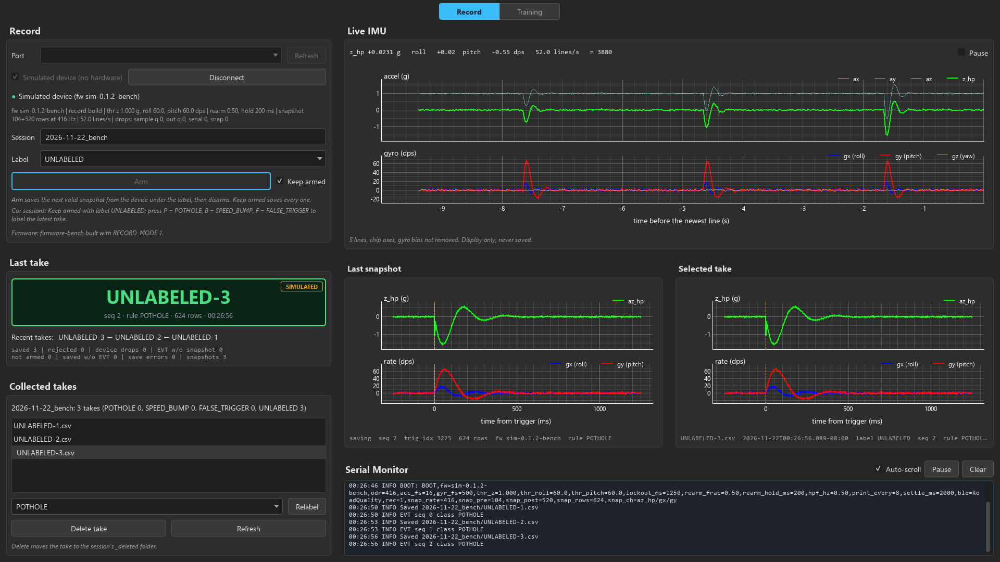

# CNN Record GUI

This program records short pieces of motion data from the road-quality board.
Later, a computer model (a "CNN") will learn from these recordings to tell
potholes, speed bumps and false alarms apart.

Every time the board feels a bump strong enough to count as an event, it sends
a 1.5-second recording of that moment to the laptop. In this guide, one of these
recordings is called a **snapshot**. When you tell the program to keep a
snapshot, it saves it as a **take**: a small file with a label such as POTHOLE.
Takes are grouped into **sessions**, for example one session for a day of bench
testing or one for each drive.

You can also run the program without the board. It then uses a pretend board
(the **simulated device**) that sends made-up snapshots. This is useful for
learning the program and for one of the tests.

The guide has three parts:

- **How to use the program:** Parts 1 to 10.
- **Tests:** what to do and what you should see.
- **If something goes wrong.**

At the end, a short section for developers describes the files.

---

## Before you start

You need:

- A Windows computer. The installation needs an internet connection; after that
  you can work offline.
- This project's files on that computer (the `ee475aut26team5` folder from GitHub).
- Python 3.11. Part 1, step 2 checks whether you already have it.
- For real recordings:
  - the ESP32-S3 DevKit board with the motion sensor wired to it;
  - a USB cable that carries data (some cables only charge);
  - the Arduino IDE, already set up for this board.
- The project owner's OK before you install the program's add-ons (Part 1,
  step 6). This is a project rule.

Two words used below:

- **Command Prompt** and **PowerShell** are the two kinds of window where you
  type commands. Type each command exactly as shown, then press Enter. Where
  the two need different commands, this guide shows both, first for
  **Command Prompt**, then for **PowerShell**. Use the one that matches your
  window: in PowerShell, each line starts with `PS`. The terminal inside VS Code
  is PowerShell unless you changed it.
- A **folder path** is the address of a folder, for example
  `C:\Users\you\Documents\GitHub\ee475aut26team5`.

---

## Part 1: Install the program (once per computer)

1. **Open a command window.** Click the Start button, type `cmd`, and press
   Enter: Command Prompt opens. PowerShell works too, for example VS Code's
   terminal (**Terminal > New Terminal**); then use the PowerShell commands.
   Don't mix them up: PowerShell doesn't understand `%USERPROFILE%`, so a
   Command Prompt command typed into PowerShell fails, or creates a folder
   literally named `%USERPROFILE%` in the wrong place.

2. **Check that Python 3.11 is installed.** Type this (the same in both windows)
   and press Enter:

   ```
   python --version
   ```

   It should answer `Python 3.11` followed by a dot and a number.

   - If it says Python is not found, go to
     https://www.python.org/downloads/windows/ and find **Python 3.11.9**. It is
     the last 3.11 version with a Windows installer. Click
     **Windows installer (64-bit)** and run the file you downloaded. On the
     installer's first screen, tick **Add python.exe to PATH**, then click
     **Install Now**. When it finishes, close the command window, open a new
     one, and check again.
   - If it shows a different version, such as 3.12 or 3.13, install 3.11.9 the
     same way. In step 5, type `py -3.11` instead of `python`.

3. **Find the program's folder.** Open File Explorer and go to the project
   folder, then into `firmware`, then `cnn`, then `cnn_record_gui`. Click once on
   the address bar at the top of the window. The address turns into text that
   is already selected. Press Ctrl+C to copy it.

4. **Go to that folder.** In Command Prompt, type `cd /d "`; in PowerShell,
   type `cd "`. Then paste the address with Ctrl+V, type a closing `"`, and press
   Enter. With your own address it looks like this:

   Command Prompt:

   ```
   cd /d "C:\Users\you\Documents\GitHub\ee475aut26team5\firmware\cnn\cnn_record_gui"
   ```

   PowerShell:

   ```
   cd "C:\Users\you\Documents\GitHub\ee475aut26team5\firmware\cnn\cnn_record_gui"
   ```

   The text in front of the blinking cursor now ends with `cnn_record_gui>`.

5. **Create the program's private add-on folder.** Type:

   Command Prompt:

   ```
   python -m venv "%USERPROFILE%\venvs\ee475-cnn"
   ```

   PowerShell:

   ```
   python -m venv "$env:USERPROFILE\venvs\ee475-cnn"
   ```

   Nothing is printed when it works. After a few seconds a new folder
   `venvs\ee475-cnn` appears in your user folder (`C:\Users\` followed by your
   name). The program's add-ons go into that folder, so they don't change
   anything else on the computer. The training program (`..\training\`) uses the
   same folder.

   The folder sits there, not inside the project folder, on purpose. TensorFlow,
   the add-on the training program needs, has very long file names. Inside the
   project folder they would go over Windows' 260-character limit for file
   paths, and the install would fail halfway. It also keeps OneDrive from
   syncing thousands of add-on files.

6. **Install the add-ons.** Get the project owner's OK first, then type:

   Command Prompt:

   ```
   "%USERPROFILE%\venvs\ee475-cnn\Scripts\python.exe" -m pip install -r requirements.txt
   ```

   PowerShell:

   ```
   & "$env:USERPROFILE\venvs\ee475-cnn\Scripts\python.exe" -m pip install -r requirements.txt
   ```

   In PowerShell, the `&` at the start is needed to run a program whose name
   is in quotes.

   This downloads four add-ons and takes a few minutes:
   - PyQt5 draws the window.
   - pyqtgraph draws the plots.
   - numpy does the number crunching.
   - pyserial talks to the board over USB.

   When it finishes, the last line starts with `Successfully installed`. A notice
   that a newer version of pip is available is fine; ignore it.

7. **Save the list of installed versions.** Type:

   Command Prompt:

   ```
   "%USERPROFILE%\venvs\ee475-cnn\Scripts\python.exe" -m pip freeze > pip-freeze.txt
   ```

   PowerShell:

   ```
   & "$env:USERPROFILE\venvs\ee475-cnn\Scripts\python.exe" -m pip freeze | Out-File -Encoding utf8 pip-freeze.txt
   ```

   This creates a file called `pip-freeze.txt` that lists exactly what was
   installed. Test GUI-1 asks for this file. In PowerShell, don't use `>` here:
   it saves the file as UTF-16, which many editors show with a space between
   every letter.

Part 1 is done. You don't need to repeat it unless you delete the
`venvs\ee475-cnn` folder.

---

## Part 2: Put the recording firmware on the board (real recordings only)

Skip this part if you only want to use the simulated device.

The board only sends snapshots when it runs the recording version of its
firmware. You switch that on with one setting.

1. Open the Arduino IDE. Choose **File > Open** and open
   `firmware\firmware-bench\firmware-bench.ino` inside the project folder.

2. Click the **config.h** tab near the top of the window. Press Ctrl+F and search
   for `RECORD_MODE`. You will find the line `#define RECORD_MODE           0`.
   Change only the `0` to `1`, then press Ctrl+S to save.

3. In the **Tools** menu, check these settings:
   - Board: **ESP32S3 Dev Module**
   - USB CDC On Boot: **Enabled**
   - USB Mode: **Hardware CDC and JTAG**
   - Flash Size: **8MB (64Mb)**
   - PSRAM: **Disabled**
   - Upload Mode: **UART0 / Hardware CDC**

4. Plug the USB cable into the board's connector labeled **USB** (not the one
   labeled UART), and the other end into the laptop. In **Tools > Port**, choose
   the board's port.

5. Click the **Upload** button: the round button with an arrow pointing right,
   at the top left. Wait for the message **Done uploading**. This takes about a
   minute.

6. **Close the Arduino IDE completely.** Only one program at a time can use the
   board's connection. If the Arduino IDE, especially its Serial Monitor, is
   still open, the record program can't connect.

When you've finished recording, change the `1` back to `0` and upload again, so
the board goes back to its normal firmware.

---

## Part 3: Start the program

Do this every time you want to use the program.

1. Open Command Prompt or PowerShell (Part 1, step 1).
2. Go to the program's folder (Part 1, steps 3 and 4).
3. Type:

   Command Prompt:

   ```
   "%USERPROFILE%\venvs\ee475-cnn\Scripts\python.exe" main.py
   ```

   PowerShell:

   ```
   & "$env:USERPROFILE\venvs\ee475-cnn\Scripts\python.exe" main.py
   ```

   After a few seconds, a window titled
   **CNN Record (firmware-bench record mode)** opens.

Leave the command window open while you work. Closing it also closes the
program.

---

## Part 4: What's on the screen



The window is always dark, whatever your computer's own theme. It has two tabs
at the top: **Record** and **Training**. Recording happens in the Record tab.
The Training tab teaches the computer model from the saved takes; it is
described in `../training/README.md`, Part 2, and needs TensorFlow, which is
installed separately (`../training/README.md`, Part 1). Without TensorFlow the
tab still opens, but a run stops with a message saying it is missing.

The Record tab has a column of controls on the left and the graphs on the right.

**On the left, from top to bottom:**

- **Record** holds the controls: Port, Refresh, Simulated device, Connect,
  Session, Label, Arm and Keep armed.
  - Under Connect, a line with a colored dot says whether you are connected,
    and to what. The dot is green when connected, amber while the program is
    trying to get the board back, and gray when not connected.
  - Under that, a gray line lists the board's settings, which appear when the
    board starts up, then how many readings arrive per second and how many the
    board has dropped. Anything that needs attention is shown in amber, such as
    **NOT a record build**.
  - The Arm button has a blue border while you are armed.
  - If the program has a problem, such as **Choose a port first**, it says so
    in red at the bottom of this panel.
- **Last take** is a card you can read from across the room. Its color says
  what just happened:
  - gray: **NOT CONNECTED**, or **READY** (connected; snapshots are shown but
    not saved);
  - blue: **ARMED** (the next snapshot is saved) or **KEEP ARMED** (every
    snapshot is saved);
  - green: a take was just saved. Its name, such as **POTHOLE-3**, is in big
    letters, with its details underneath. After you press P, B or F, the card
    shows the new name and **Relabeled**;
  - amber: **REJECTED**, a snapshot arrived damaged and was thrown away. The
    reason is underneath;
  - red: **FAULT**, the board reported a problem. It stays until you click
    Connect again.

  A saved or rejected snapshot stays on the card for at least 2 seconds. If
  you are armed, the card then goes back to ARMED or KEEP ARMED; if not, the
  take's name stays up. A **SIMULATED** tag in the corner means the newest
  snapshot came from the simulated device. Under the card, **Recent takes**
  lists the last five takes saved, newest first, and the small line under that
  shows the counters (explained below).
- **Collected takes** lists the takes saved in the current session, oldest
  first, with buttons to relabel or delete one.

If the window is too short for all three, the left column scrolls.

**On the right, from top to bottom:**

- **Live IMU** shows what the sensor is reading right now, as a trace that
  scrolls from right to left over the last 10 seconds. It is only for watching:
  nothing in it is ever saved.
  - The top graph shows acceleration along the board's three directions
    (`ax`, `ay`, `az`), plus `z_hp`, the up-and-down acceleration with gravity
    taken out (the same signal as in the snapshot plots).
  - The bottom graph shows how fast the board is turning around each direction
    (`gx`, `gy`, `gz`). These still include the sensor's small resting offset,
    which the snapshots have removed, so they may sit slightly off zero.
  - The line of numbers above the graphs shows the newest `z_hp`, roll and
    pitch, and how many readings arrive per second (about 52). Point at it to
    see all seven values.
  - A tag beside the numbers says **Not connected**, **PAUSED**, or, in amber,
    **NO S LINE FOR** a number of seconds when the board stops sending readings.
  - Tick **Pause** to freeze the trace so you can look at it. Readings keep
    arriving; untick it to follow live again.
- **Last snapshot** and **Selected take**, side by side:
  - **Last snapshot** plots the newest snapshot from the board, whether or not
    it was saved. The line of text under it starts with **saving** or **not
    armed: not saved**.
  - **Selected take** plots the take you clicked in the list. The line of text
    under it starts with the file name and the time it reached the laptop.
  - In both, the top graph shows up-and-down acceleration, and the bottom graph
    shows how fast the board is rolling (side to side) and tipping (front to
    back). The dashed amber line marks the moment the board detected the event.
  - If a line of text ends with "…", point at it to read all of it.
- **Serial Monitor** is a list of what happened, with the time of each line.
  Warnings are amber and errors red. The same lines go into a log file
  (Part 9).
  - **Auto-scroll** keeps the newest line in view.
  - **Pause** freezes the list so you can read it. Click **Resume**, and the
    lines that came in meanwhile appear.
  - **Clear** empties the list on screen. The log file keeps everything.

Each graph has its name in its top left corner, for example **accel (g)**, and
its color key in its top right corner. Click a name in the color key to hide or
show that line. A signal has the same color in every graph: `z_hp` green, roll
blue, pitch red. To make a part of the window bigger, drag the gap next to it:
between the left column and the graphs, under Live IMU, or above Serial Monitor.

The counters mean:

- **saved**: takes written to disk.
- **rejected**: snapshots that arrived damaged or incomplete and were thrown
  away. These are never saved.
- **device drops**: events the board couldn't send a snapshot for, as reported
  by the board itself.
- **EVT w/o snapshot**: events the board announced whose snapshot never arrived
  in good shape.
- **not armed**: good snapshots that arrived while you weren't armed. They are
  shown but not saved.
- **saved w/o EVT**: takes saved without the board's own guess of the event
  type, because that message didn't arrive within 5 seconds. The take itself
  is fine.
- **save errors**: takes that couldn't be written to disk.
- **snapshots**: all good snapshots received.

---

## Part 5: Try it with the simulated device

1. Start the program (Part 3).
2. In **Session**, type a name such as `practice_sim` and press Enter. Session
   names may use letters, numbers, `_` and `-`, but no spaces.
3. Tick **Simulated device (no hardware)**, then click **Connect**. The
   connection line says **Simulated device (fw sim-0.1.2-bench)** next to a
   green dot, and the **Last take** card says **READY**. **Live IMU** starts
   scrolling, and the numbers above it show about **52.0 lines/s**.
4. A new snapshot appears in **Last snapshot** about every 3 seconds. Each
   pretend event shows up in **Live IMU** first, as a swing in the lines, and
   its snapshot arrives about 1.5 seconds later. You
   aren't armed yet, so the text under the plot starts with
   **not armed: not saved**, and the **not armed** counter goes up.
5. Tick **Keep armed**. The card turns blue and says **KEEP ARMED**. From now on
   every good snapshot is saved: the card turns green with the new take's name
   for 2 seconds, and the take appears in **Collected takes**.
6. Some pretend snapshots are damaged on purpose. The card turns amber and says
   **REJECTED**, with the reason; they raise the **rejected** counter and are
   never saved. Every so often the pretend board also restarts,
   or its pretend cable drops out for 2 seconds. The program recovers by itself.
7. Click **Disconnect** when you are done.

Takes from the simulated device are marked as fake inside the file: their `fw`
value starts with `sim-`, so they can't be mixed up with real data. You can
delete the practice session's folder afterwards (Part 9 says where it is).

---

## Part 6: Record on the bench

1. Do Part 2, so the board runs the recording firmware. Plug the board's **USB**
   connector into the laptop.

2. Start the program (Part 3).

3. In the **Port** list, choose the board: the entry that ends in `[303A:1001]`.
   If it isn't listed, click **Refresh**.

4. Click **Connect**. The connection line says **Connected to COM** followed by
   a number, next to a green dot, and the board's settings appear in the gray
   line under it. That line should include **record build**. **Live IMU** starts
   scrolling at about 52 lines per second. With the board lying flat, `az` sits
   near 1 g and moves when you touch the board.
   - If the settings line keeps saying **No device info yet**, press the **RST**
     button on the board once. The board restarts and sends its settings.
   - After the board starts, wait 5 seconds before you tap it.

5. In **Session**, type a name for this session, such as `2026-11-20_bench`, and
   press Enter.

6. In **Label**, choose what you are about to record: POTHOLE, SPEED_BUMP or
   FALSE_TRIGGER. Ask the project owner which movement to use for each label,
   and use the same movement every time. Example movements:
   - POTHOLE: quickly tip the end of the sensor board that its X arrow points
     to down, then back up.
   - SPEED_BUMP: tip that same end up, then back down.
   - FALSE_TRIGGER: a sharp tap that is neither of those.

7. Click **Arm**. The **Last take** card turns blue and says **ARMED**, with the
   label underneath.

8. Tap the board firmly, once. The tap shows in **Live IMU** straight away.
   About a second and a half later:
   - the snapshot appears in **Last snapshot**;
   - the new take appears in **Collected takes**;
   - the card turns green and shows the take's name, such as **POTHOLE-1**.

   The program then disarms by itself, so the next snapshot isn't saved until
   you click **Arm** again. The take's name stays on the card until then.

9. Repeat steps 6 to 8 for each take. Wait about 3 seconds between taps.
   Otherwise the board counts two taps as one event.

To save many takes with the same label without clicking Arm each time, tick
**Keep armed** instead. Every snapshot is then saved under the chosen label
until you untick it.

---

## Part 7: Record in a car

This needs two people. One drives. The other, the passenger, handles the
laptop. The driver never touches the laptop.

1. Before the drive:
   - Do Part 2.
   - Mount the board in the car the way the project owner says.
   - Plug the board into the laptop.
   - Set the laptop so it doesn't go to sleep, and make sure it is charged.

2. Start the program (Part 3), choose the board's port and click **Connect**
   (Part 6, steps 3 and 4).

3. In **Session**, type a name for the drive, such as `2026-11-22_car_route1`,
   and press Enter. Pressing Enter matters: until you do, the letter keys in
   step 5 would type into the Session box instead of labeling takes.

4. In **Label**, choose **UNLABELED**, then tick **Keep armed**. Every snapshot
   is now saved, even the ones nobody has time to label.

5. During the drive, each time the car goes over something, the passenger
   presses one key right after the new take appears. Its name shows in green on
   the **Last take** card for 2 seconds and stays first in **Recent takes**.
   - **P** for a pothole;
   - **B** for a speed bump;
   - **F** for anything else that set it off (a false trigger).

   The newest take gets that label, and the card shows its new name with
   **Relabeled**. If you aren't sure, press nothing, and the take stays
   UNLABELED.

6. The passenger should also write down the clock time of each pothole or speed
   bump, or the car can record dashcam video. Either helps when labeling the
   rest later.

7. After the drive, label the remaining UNLABELED takes (Part 8). The time shown
   under the **Selected take** plot, after the file name, is when the take
   reached the laptop, about 1 to 2 seconds after the bump.

The program keeps working through bumps, a board restart, or a cable that drops
out briefly. Takes that are already saved are never lost.

---

## Part 8: Look at, relabel or delete a take

- **To look at a take,** click it in **Collected takes**. The take is drawn in
  **Selected take**, with its file name, label and time underneath. The line
  above the list shows how many takes the session has with each label.
- **To change a take's label,** click the take, choose the new label in the
  box next to **Relabel**, and click **Relabel**. The file is renamed, for
  example from `UNLABELED-4.csv` to `POTHOLE-7.csv`, and keeps its place in the
  list.
- **To delete a take,** click the take, click **Delete take**, then click
  **Yes**. The take isn't destroyed. It moves to a folder called `_deleted`
  inside the session's folder. To bring it back, use File Explorer to move the
  file from `_deleted` back into the session folder, then click **Refresh**.
- **To see another session,** type its name in **Session** and press Enter.

---

## Part 9: Where everything is saved

- **Takes** are saved in `firmware\cnn\data\`, with one folder per session.
  Each take is one file named after its label and a number, for example
  `POTHOLE-3.csv`. A number is never reused within a session, even after a
  delete.
- **Deleted takes** go to the `_deleted` folder inside their session folder.
- **Takes and logs stay on this computer.** `firmware\cnn\.gitignore` keeps
  `data\`, `logs\` and `__pycache__\` out of Git, so nothing you record goes to
  GitHub. Share takes with the team another way.
- **The log** is saved in `firmware\cnn\logs\`, one file per day, named
  `record_gui_` followed by the date. Each line has the time and what happened:
  - connections and disconnections;
  - saved takes;
  - damaged snapshots and why they were thrown away;
  - board restarts.

---

## Part 10: Stop the program

Click **Disconnect**, then close the window with the X in its top right
corner. Next time, the program remembers the last port and session name.

---

## Tests

There are two kinds of tests:

- the **automatic checks**, which the computer runs by itself in a few seconds;
- tests **GUI-1 to GUI-4**, which you do by hand with the program open.

Each test says what it checks, what to do, what you should see, when it counts
as failed, and what to save as proof. Only the project owner marks a test as
passed. Your job is to collect the proof and describe what you saw. The board's
own tests (TRG and REC) are listed in the CNN handoff document, not here.

To take a screenshot, press Windows+Shift+S and drag a box around what you
want. Then click the preview that pops up in the corner of the screen, and save
it.

### Automatic checks

**What they check:**

- the program reads the board's messages correctly;
- it throws away every kind of damaged snapshot;
- it matches each snapshot with the board's event message;
- it saves, renames and deletes take files correctly.

They don't open the window, and they need neither the board nor the add-ons.

**What to do:**

1. Open Command Prompt or PowerShell and go to the program's folder (Part 1,
   steps 1, 3 and 4).
2. Type (the same in both windows):

   ```
   python -m unittest discover -s tests
   ```

**What you should see:** a row of dots, then a line starting with
`Ran 59 tests in`, and `OK` on the last line.

**It fails if** the last line says `FAILED`. Copy all of the text from the
window and send it to the project owner.

### GUI-1: Install and start

**What it checks:** the program installs from scratch with the listed add-ons
and opens with only the Record and Training tabs.

**What to do:**

1. If the folder `venvs\ee475-cnn` already exists in your user folder
   (`C:\Users\` followed by your name), delete it in File Explorer, so the
   installation starts from nothing. This also removes TensorFlow, if the
   training program was installed; install it again afterwards
   (`..\training\README.md`, Part 1).
2. Do all of Part 1, then Part 3.

**What you should see:**

- Part 1, step 6 ends with a line starting with `Successfully installed`.
- The file `pip-freeze.txt` now exists in `cnn_record_gui`.
- When the program starts, the command window shows a line containing
  `Record GUI start, commit`. The line goes on with a long code of letters and
  numbers (or the word `unknown` if Git isn't installed), then says where takes
  and the log are saved.
- A window titled **CNN Record (firmware-bench record mode)** opens with exactly
  two tabs, **Record** and **Training**. There are no other tabs.

**It fails if** the installation stops with an error (a line with `ERROR` in
it), the window doesn't open, or the window has other tabs.

**Proof to save:**

- a screenshot of the command window;
- the `pip-freeze.txt` file;
- a screenshot of the program window.

### GUI-2: Normal recording on the bench

**What it checks:** arming, tapping and saving work, and every take is complete,
with the right label and session.

**What to do:**

1. Follow Part 6 with a new session name, for example `2026-11-20_gui2`.
2. Record 10 takes labeled POTHOLE, 10 labeled SPEED_BUMP and 10 labeled
   FALSE_TRIGGER. Click **Arm** before each tap.

**What you should see:**

- After each tap, exactly one new take appears in the list, and the **Last
  take** card turns green with its name. The Arm button loses its blue border:
  the program has disarmed.
- At the end, the line above the list reads
  `... 30 takes (POTHOLE 10, SPEED_BUMP 10, FALSE_TRIGGER 10, UNLABELED 0)`, and
  the **saved** counter shows 30.
- Check two or three take files in Notepad. In File Explorer, right-click the
  file, choose **Open with**, then **Notepad**.
  - The first lines start with `#`. Among them are:
    - `# label=` followed by the take's label;
    - `# session=` followed by the session name;
    - `# n_rows=624`.
  - Press Ctrl+End to jump to the end of the file. The bar at the bottom of
    Notepad shows **Ln 651**. That is 26 description lines, plus 624 lines of
    numbers, plus the empty line after the last one. If you don't see the bar,
    turn it on in the **View** menu.

A tap that doesn't show up in **Last snapshot** at all wasn't strong enough.
That isn't a failure; just tap again.

**It fails if:**

- a snapshot appears while you are armed, but no take is saved;
- a take has the wrong label or session;
- a take file doesn't show Ln 651 in Notepad.

**Proof to save:**

- a screenshot of the program at the end;
- a screenshot of the session's folder in `firmware\cnn\data\`.

### GUI-3: Damaged data, restarts and reconnecting (simulated device)

**What it checks:**

- damaged snapshots are thrown away and counted;
- snapshots that arrive while you aren't armed are not saved;
- after the pretend cable drops out, the program reconnects and saves the next
  take.

You need a stopwatch, or the timer on your phone.

**What to do:**

1. Start the program (Part 3). In **Session**, type `gui3_sim` and press Enter.
   Make sure **Keep armed** is not ticked.
2. Tick **Simulated device (no hardware)**. Click **Connect**, and start the
   stopwatch at the same moment.
3. Do nothing for the first 10 seconds. Three snapshots appear, each marked
   **not armed: not saved**, and nothing is added to the list.
4. At about 10 seconds, tick **Keep armed**.
5. Watch until about 70 seconds, then click **Disconnect**. Wait 10 more seconds
   before you read the counters.

**What you should see** (all times are counted from when you clicked Connect):

- A new snapshot about every 3 seconds. From step 4 on, each good one appears
  as a new take in the list.
- A damaged snapshot at about 12, 24, 37, 40 and 51 seconds. Each time:
  - nothing is added to the list;
  - **rejected** goes up by one;
  - the card turns amber and says **REJECTED** for 2 seconds;
  - the **Serial Monitor** shows an amber line with `Snapshot rejected` and a
    reason.

  The five reasons, in order, are:
  1. `gap in i (expected 312, got 313)`: one line of the snapshot was missing.
  2. `CRC mismatch`, followed by two codes: the data was changed on the way.
  3. `wrong row count (SNB 624, SNE 624, received 600)`: the snapshot was too
     short.
  4. `USB lost mid-snapshot (simulated)`: the pretend cable dropped out halfway
     through. The connection line shows **Simulated USB drop-out** for 2
     seconds, then **Simulated device (reconnected)**. The Serial Monitor shows
     `Reconnected: unmatched items cleared`.
  5. `missing SNE (interrupted by EVT)`: the snapshot's end marker never came.
- At about 26 and 55 seconds, and again right after the reconnect, the pretend
  board restarts. The Serial Monitor shows a line starting with `BOOT:`, and the `seq`
  number under **Last snapshot** starts again from 0 with the next snapshot.
  The **Live IMU** trace starts over at the same moment.
- At about 45 seconds, the first snapshot after the reconnect is saved and
  appears in the list.
- At about 63 seconds, the pretend board reports an event it had no room to
  send. No snapshot appears, and **device drops** becomes 1. About 5 seconds
  later, **EVT w/o snapshot** goes up by one.

When you read the counters at the end, they should show:

- **rejected 5**
- **device drops 1**
- **EVT w/o snapshot 5**
- **saved w/o EVT 0**
- **save errors 0**

With the timing above, **saved** is 13, **not armed** is 3 and **snapshots** is
16. If your timing was a little different, saved and not armed can be off by one
or two. Two things are always true, though: saved plus not armed equals
snapshots, and the number of takes in the list equals saved. If you waited past
75 seconds, rejected shows 6. That's also correct, because a sixth damaged
snapshot arrives at about 75 seconds.

**It fails if:**

- a damaged snapshot shows up in the list;
- a snapshot is saved while you weren't armed;
- the program freezes or closes;
- no take is saved after the reconnect.

**Proof to save:**

- a screenshot of the program at the end, with the counters visible;
- the log file (Part 9);
- a screenshot of the `firmware\cnn\data\gui3_sim` folder.

### GUI-4: Unplugging the cable during a snapshot

**What it checks:** if the cable is pulled out while a snapshot is arriving, the
half-received snapshot is thrown away, the program stays open, and it
reconnects by itself when the cable goes back in.

This test needs the board (with Part 2 done) and good timing, so it may take a
few tries.

**What to do:**

1. Follow Part 6, steps 1 to 5, with the session name `gui4_unplug`. Choose the
   label UNLABELED and tick **Keep armed**.
2. Tap the board once and check that a take is saved, so you know everything
   works.
3. Tap the board again, and about one second later, pull the USB cable out of
   the laptop. The board sends its snapshot about 1.25 seconds after a tap, so
   you want to pull the cable just as the snapshot is arriving.
4. Look at the newest amber line in the **Serial Monitor** (the card shows
   **REJECTED** for only 2 seconds).
   - If it is `Snapshot rejected` and ends with `USB lost mid-snapshot`, you
     caught the snapshot in the middle. Go on to step 5.
   - If a new take was saved instead, you were too late. If nothing changed,
     you were too early. In either case, plug the cable back in, wait 5 seconds,
     and repeat step 3.
5. Wait about 10 seconds, then plug the cable back into the same USB socket.
6. Wait 5 seconds, then tap the board once more.

**What you should see:**

- While the cable is out:
  - the program stays open and keeps responding;
  - the connection line says **Lost COM** and a number, then **Waiting for COM**
    and the number, next to an amber dot, and the card says **NOT CONNECTED**;
  - **rejected** has gone up by one, with the reason `USB lost mid-snapshot`;
  - no new take appears for the interrupted snapshot.
- After the cable goes back in:
  - within about 2 seconds, the connection line says **Connected to COM** and
    the number;
  - the Serial Monitor shows `Reconnected: unmatched items cleared`;
  - the board restarted when it lost power, so its settings line appears again.
- The tap in step 6 is saved as a new take.

If the board's second cable (the one in the UART connector) is also plugged in,
the board keeps running when you pull the USB cable. Its settings line then
won't reappear, and that's fine.

**It fails if:**

- the program closes or freezes;
- a take appears for the interrupted snapshot;
- the program doesn't reconnect after the cable goes back in.

**Proof to save:**

- the log file (Part 9);
- a screenshot of the program after step 6.

---

## If something goes wrong

- **It says `'python' is not recognized` or `Python was not found`.**
  Python isn't installed, or it wasn't added to PATH. See Part 1, step 2.

- **PowerShell says `Unexpected token '-m'` (or `'main.py'`).** The `&` at the
  start of the command is missing. Use the PowerShell version of the command.

- **It says `The system cannot find the path specified`, or
  `...\ee475-cnn\Scripts\python.exe` is not recognized.** Part 1 isn't done, or
  a Command Prompt command (with `%USERPROFILE%`) was typed into PowerShell.
  Use the version for your window, and check that the folder `venvs\ee475-cnn`
  exists in your user folder. If it says it can't open `main.py`, the window
  isn't in the program's folder: repeat Part 1, steps 3 and 4.

- **A folder named `%USERPROFILE%` appeared** (usually in your user folder or
  the project folder). Part 1, step 5 was typed into PowerShell in its Command
  Prompt form, so the add-on folder was made in the wrong place. Delete the
  `%USERPROFILE%` folder in File Explorer and do step 5 again with the
  PowerShell command.

- **It says `No module named PyQt5` (or pyqtgraph, or serial).** The add-ons
  aren't installed in the program's private folder. Repeat Part 1, step 6. Start
  the program with the command in Part 3, not with `python main.py`.

- **The board isn't in the Port list.**
  1. Click **Refresh**.
  2. Check that the cable is in the board's **USB** connector, and that it's a
     data cable.
  3. Close the Arduino IDE.

- **Live IMU stays empty, or says NO S LINE FOR a number of seconds.** The
  board isn't sending readings. If the connection line says **Waiting for**,
  the cable or board is gone: check the cable. Otherwise press **RST** on the
  board. Snapshots can still arrive while the live view is empty, and they are
  saved as usual.

- **The program is connected, but no snapshots appear when you tap.** Look at
  the board's settings line (the gray line under the connection line).
  - If it says **NOT a record build** in amber, the board has its normal
    firmware. Do Part 2.
  - If it says **No device info yet**, press **RST** on the board and wait 5
    seconds.
  - Otherwise, tap harder.

- **Snapshots appear but aren't saved.** The **Last take** card probably says
  **READY**. Click **Arm**, or tick **Keep armed**. If a red message says the
  session name isn't valid, fix the name and press Enter.

- **The card says FAULT.** The board reported a problem; the Serial Monitor
  also shows it as an amber `FLT` line with its code. Write the code down for
  the project owner. The card clears the next time you click **Connect**.

- **device drops keeps going up.** You are tapping too quickly (wait 3 seconds
  between taps), or tapping right after the board starts (wait 5 seconds).

- **Pressing P, B or F typed a letter into the Session box.** Click in the
  Session box, delete the letter, press Enter, then press the key again.

- **The window closed unexpectedly.** Start it again (Part 3). Takes that were
  already saved are safe, and the log file says what happened.

---

## For developers

**Take file format.** Each take file, `<LABEL>-<n>.csv`, has two parts:

- **26 `# key=value` header lines:**
  - label, session, PC times (`pc_received`, and `pc_trigger_est` = received
    minus `n_post / rate_hz`), `gui_commit` (this checkout, not necessarily what
    is flashed) and `fw`;
  - every SNB setting;
  - the EVT's rule class and peaks as `rule_*` (`missing` if the EVT didn't
    arrive);
  - the raw EVT and BOOT lines;
  - `columns`.
  - A relabel adds a `# relabeled=` line.
- **624 data rows** of `c0,c1,c2`: `az_hp` in g, `gx` (roll rate) and `gy`
  (pitch rate) in dps, exactly as the firmware printed them. Row `n_pre` (104) is
  the trigger sample. `np.loadtxt(path, delimiter=",")` reads the rows, since `#`
  lines count as comments.

**Live IMU.** Both firmware builds send an S line every `PRINT_EVERY_N` (8)
samples, ~52 per second: `S,n,t_us,ax,ay,az,gx,gy,gz,z_hp`, chip axes, accel in
g, gyro in dps with the settle-time bias still in, `z_hp` in g. The reader
parses them into `SampleLine` and sends them only to `LivePlot`; they never
reach `record_core`, so they cannot end up in a take. The firmware never puts
an S line inside a snapshot block, so one there still rejects the snapshot. A
gap of more than `LIVE_GAP_S` in device time is drawn as a break, and device
time going backwards (a reset) clears the trace. The simulated device sends S
lines too, including each event's shape while the event happens. Settings:
`LIVE_*` in `../cnn_config.py`.

**Look.** The window copies the dark look of Jake's ml-on-device-playground
(https://github.com/jake-g/ml-on-device-playground, branch codegen-classroom:
its Playground layout, its Current Classification card and its Serial
Monitor), and forces it on every OS: `main.py` calls `apply_theme()` once,
which sets the Fusion style, a dark palette, one app-wide style sheet and
pyqtgraph's colors. Every color, font size and spacing is a named token in
`app_styles.py`; widgets never set a color themselves, they get a style role
with `set_role()` (and `set_state()` for the card's accents). To change a
color, change its token. The combo-box arrow is the one exception that needs a
file: `apply_theme()` writes two tiny SVGs, in the token colors, to
`%TEMP%\cnn_record_gui_theme\` at every start. On Windows 10 and 11 the title
bar is dark too.

**Code.**

| File | What it does |
| --- | --- |
| `main.py` | Starts the program; sets up the log, the error hook and the dark theme |
| `app_styles.py` | The look: color, font and size tokens, the style sheet, the dark palette and title bar |
| `main_window.py` | The window, the tabs, the layout and its splitters |
| `training_widget.py` | The Training tab: picks sessions, runs `../training/train.py` in the background, shows its log |
| `record_widget.py` | The Record panel; connects the USB reader to the record logic and drives the Last take card |
| `status_card.py` | The Last take card (display only) |
| `collected_data_widget.py` | The Collected takes panel |
| `snapshot_plot.py` | The Last snapshot and Selected take plots, and the plot style shared with Live IMU |
| `live_plot.py` | The Live IMU view: draws the S lines (display only) |
| `serial_monitor.py` | The Serial Monitor panel: the GUI's log lines, colored by level |
| `elided_label.py` | A one-line label that cuts long text with "…" and shows it in full in a tooltip |
| `live_buffer.py` | The last 10 s of S lines for Live IMU, with breaks where lines are missing (standard library only) |
| `serial_handler.py` | Reads USB in the background and reconnects; never sends anything to the board |
| `snapshot_protocol.py` | Checks and assembles snapshots; reads the other lines, S included (standard library only) |
| `record_core.py` | Arm, labels, matching snapshots with EVT lines, timeouts (standard library only) |
| `take_store.py` | Writes, renames and deletes take files (standard library only) |
| `sim_source.py` | The simulated device (standard library only) |
| `../cnn_config.py` | Every adjustable setting (DRAFT values) |
| `tests/` | The automatic checks |

**Credits.** Several files are adapted from
[jake-g/ml-on-device-playground](https://github.com/jake-g/ml-on-device-playground),
a fork of [anandghanw/ml-on-device-playground](https://github.com/anandghanw/ml-on-device-playground),
under the MIT license. See `LICENSE-ml-on-device-playground.txt`; each adapted
file says in its header what it came from and what changed.
